## Outline

:::: {.columns}
::: {.column width="50%"}

1. Causal Inference and Bayes
2. Bayesian A/B Testing
3. Regression and the `do` Operator
4. Marketing Mix Models
5. Unobserved Confounders

:::

::: {.column width="50%"}

6. ROAS and Lift Test Calibration
7. Funnel Models in Marketing
8. Causal Identification in Funnel Models
9. References

:::
::::

## What is Causal Inference? {.smaller}

- **Goal:** Estimate the effect of a treatment $T$ on an outcome $Y$.
- **Potential outcomes** (Rubin, 1974): for each unit $i$ there are two potential outcomes:
  - $Y_i(1)$: outcome if treated
  - $Y_i(0)$: outcome if not treated
- **Individual treatment effect:** $\tau_i = Y_i(1) - Y_i(0)$
- **Average treatment effect (ATE):**

$$
\text{ATE} = \text{E}[Y(1) - Y(0)]
$$

::: {.callout-warning}

## The Fundamental Problem of Causal Inference

We never observe both $Y_i(1)$ and $Y_i(0)$ for the same unit. One potential outcome is always missing: the **counterfactual**.

$$
\text{Observed: } Y_i = T_i \cdot Y_i(1) + (1 - T_i) \cdot Y_i(0)
$$

A naive comparison of treated and untreated units can be biased because the two groups can differ in **confounders**.

:::

## What is Bayesian Statistics? {.smaller}

We use Bayes' theorem to update our beliefs about parameters $\theta$ after we observe data $y$:

$$
\underbrace{p(\theta \mid y)}_{\text{posterior}} \propto \underbrace{p(y \mid \theta)}_{\text{likelihood}} \cdot \underbrace{p(\theta)}_{\text{prior}}
$$

::: incremental

- **Prior** $p(\theta)$: domain knowledge before we see the data.
- **Likelihood** $p(y \mid \theta)$: how probable the data is for given parameters.
- **Posterior** $p(\theta \mid y)$: updated beliefs after we see the data.

:::

::: {.callout-tip}
## From Generative Model to Inference

A probabilistic program describes how the data is generated. Before we observe data, every variable has a prior distribution. When we condition on observed data, the same program defines the likelihood. If we read its arrows as causal, the same program is both the causal model and the Bayesian model.
:::

::: {.callout-note}

## Probabilistic Programming Languages (PPLs)

PPLs let us write generative models as code and run posterior inference automatically. Examples: [PyMC](https://www.pymc.io/), [NumPyro](https://num.pyro.ai/), [Stan](https://mc-stan.org/).

:::

## Why PPLs for Causal Inference? {.smaller}

In industry, we estimate causal effects from limited data and under assumptions we cannot fully test. PPLs help in the following ways:

::: {.callout-tip appearance="simple"}

- **The model is the DAG:** we write the data-generating process as code, so every causal assumption is explicit.

- **Priors:** domain knowledge and past experiments enter the estimate (A/B testing, ROAS calibration).

- **Uncertainty:** we get a posterior distribution for every causal quantity.

- **The `do` operator:** we apply interventions to the model and compute counterfactuals (`pm.do` in PyMC, `numpyro.handlers.do` in NumPyro).

- **Flexible structure:** non-linear likelihoods, latent variables, measurement models, and shared and geo-specific parameters. The `do` operator still applies.

:::

::: {.callout-warning appearance="simple"}
This does not mean that Bayesian methods are better than frequentist methods. Every framework has assumptions and limitations.

PPLs do not solve **identification**. They help with **estimation** once we state the causal assumptions.
:::

## Bayesian A/B Testing {.smaller}

::: {.callout-tip appearance="simple"}
In an A/B test, we randomly assign users to a control group and a treatment group. Random assignment makes the treatment independent of all confounders, observed and unobserved. The hard part moves from identification to estimation under uncertainty. We observe $N_\text{c}$ and $N_\text{t}$ conversions out of $N$ users per group.
:::

```{.python code-line-numbers="|1|2-4|5-7|8-11|"}
with pm.Model() as non_informative_model:
    conversion_rate_control = pm.Uniform(
      "conversion_rate_control", lower=0, upper=1
    )
    conversion_rate_treatment = pm.Uniform(
        "conversion_rate_treatment", lower=0, upper=1
    )
    relative_lift = pm.Deterministic(
        "relative_lift",
        conversion_rate_treatment / conversion_rate_control - 1,
    )
```

:::: {.columns}
::: {.column width="70%"}

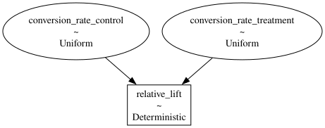{fig-align="center" width="480"}

:::
::: {.column width="30%"}

\begin{align*}
\text{cr}_\text{c} & \sim \text{Beta}(1, 1) \\
\text{cr}_\text{t} & \sim \text{Beta}(1, 1) \\
\text{lift} & = \text{cr}_\text{t} / \text{cr}_\text{c} - 1 \\
N_{\text{c}} & \sim \text{Binomial}(N, \text{cr}_\text{c}) \\
N_{\text{t}} & \sim \text{Binomial}(N, \text{cr}_\text{t}) \\
\end{align*}

:::
::::

::: footer
[Prior Predictive Modeling in Bayesian A/B Testing](https://juanitorduz.github.io/prior_predictive_ab_testing/)
:::

## Uninformative Priors {.smaller}

::: {.callout-important}
## Uninformative priors give implausible values for the relative lift.

The relative lift is a ratio of two random variables. With flat priors on the two conversion rates, the prior allows a treatment that is $100$ times better than control.

:::

:::: {.columns}
::: {.column width="40.5%"}

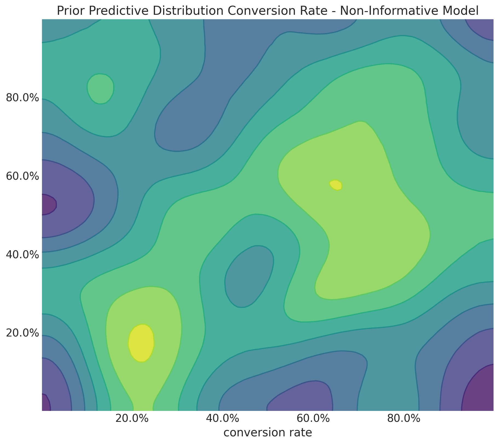{fig-align="center" width="700"}

:::
::: {.column width="59.5%"}

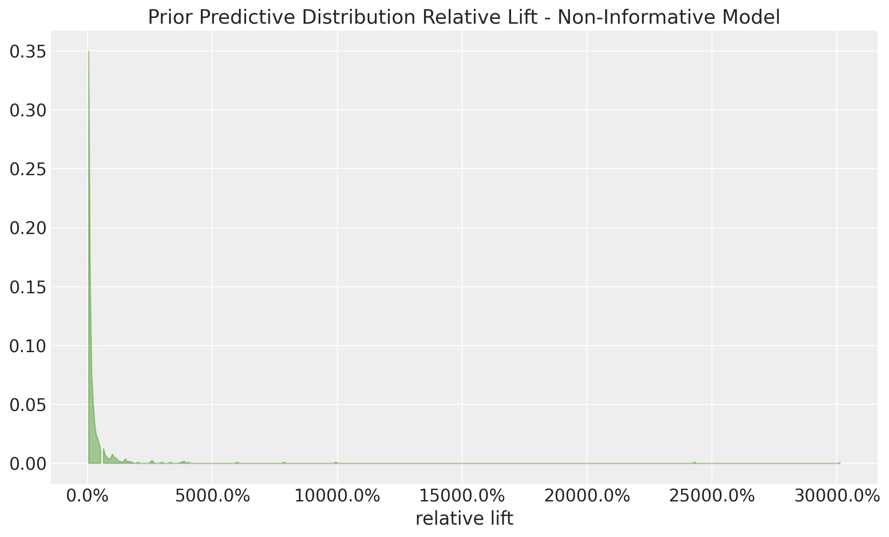{fig-align="center" width="700"}

:::
::::

::: footer
[Prior Predictive Modeling in Bayesian A/B Testing](https://juanitorduz.github.io/prior_predictive_ab_testing/)
:::

## Informative Priors {.smaller}

:::: {.columns}
::: {.column width="30%"}

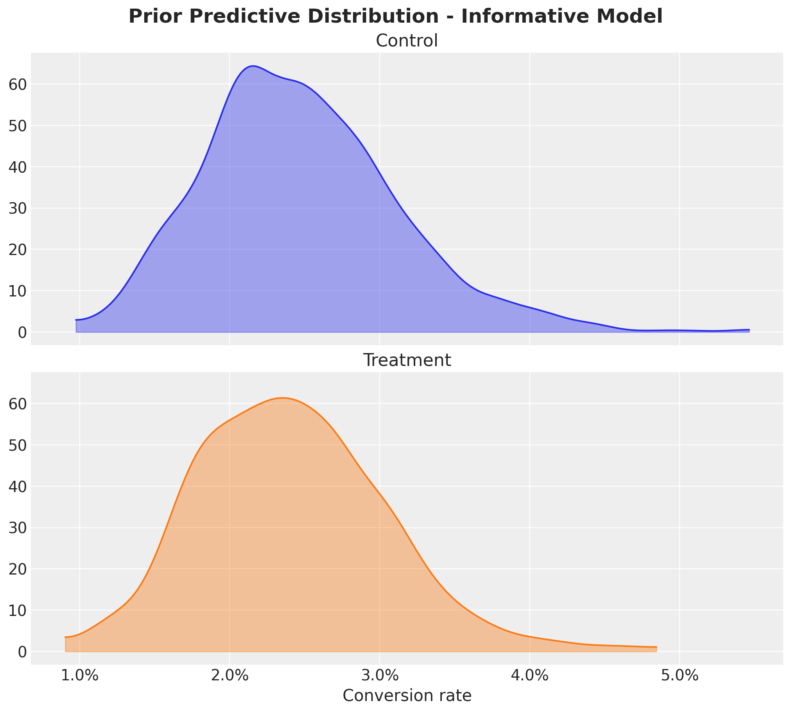{fig-align="center" width="260"}

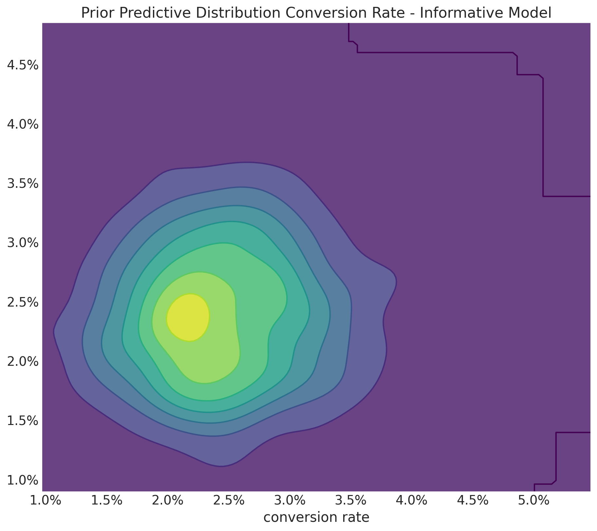{fig-align="center" width="260"}

:::

::: {.column width="70%"}

::: {.callout-warning}
## Informative priors on each rate are not enough.

With $\text{cr}_\text{c}, \text{cr}_\text{t} \sim \text{Beta}(15, 600)$, both conversion rates are close to $2.4\%$. Still, the prior allows lifts of $50\%$, which are rare in practice.

:::

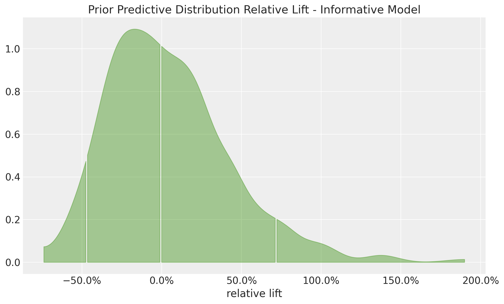{fig-align="center" width="620"}

:::

::::

::: footer
[Prior Predictive Modeling in Bayesian A/B Testing](https://juanitorduz.github.io/prior_predictive_ab_testing/)
:::

## Correlated Priors {.smaller}

We know that most true lifts are small. So we set the prior on the **relative lift** itself.

:::: {.columns}
::: {.column width="55%"}

```{.python code-line-numbers="|2-4|5-7|8-11|"}
with pm.Model() as correlated_model:
    conversion_rate_control = pm.Beta(
      "conversion_rate_control", alpha=15, beta=600
    )
    relative_lift = pm.Normal(
      "relative_lift", mu=0, sigma=0.1
    )
    conversion_rate_treatment = pm.Deterministic(
        "conversion_rate_treatment",
        conversion_rate_control * (1 + relative_lift)
    )
```

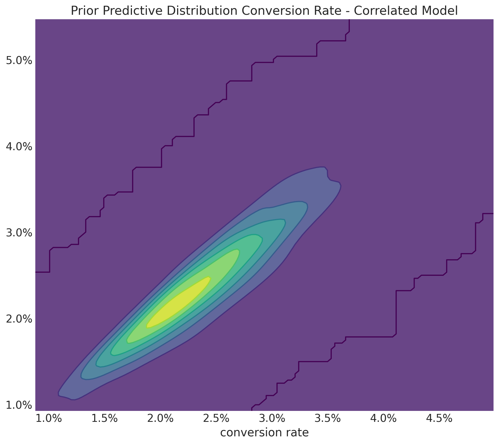{fig-align="center" width="260"}

:::

::: {.column width="45%"}

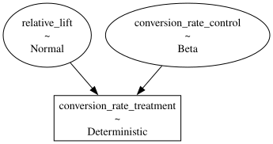{fig-align="center" width="360"}

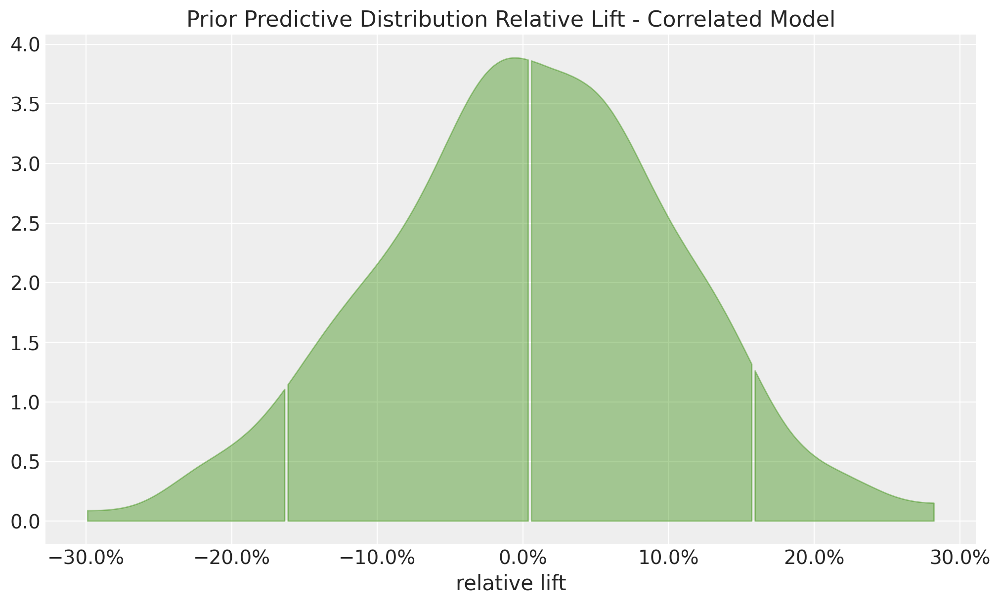{fig-align="center" width="380"}

:::
::::

::: footer
[Prior Predictive Modeling in Bayesian A/B Testing](https://juanitorduz.github.io/prior_predictive_ab_testing/)
:::

## Inference with Correlated Priors {.smaller}

We observe $200$ and $350$ conversions out of $10{,}000$ users per group (a naive lift of $75\%$). The posterior shrinks both conversion rates toward the prior, so the lift estimate is more conservative.

```{.python code-line-numbers="|2-4|5-7|"}
with correlated_model:
    pm.Binomial(
      "n_control", n=n, p=conversion_rate_control, observed=n_c
    )
    pm.Binomial(
      "n_treatment", n=n, p=conversion_rate_treatment, observed=n_t
    )
```

:::: {.columns}
::: {.column width="40%"}

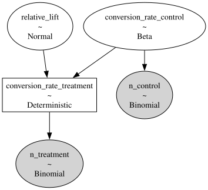{fig-align="center" width="300"}

:::

::: {.column width="60%"}

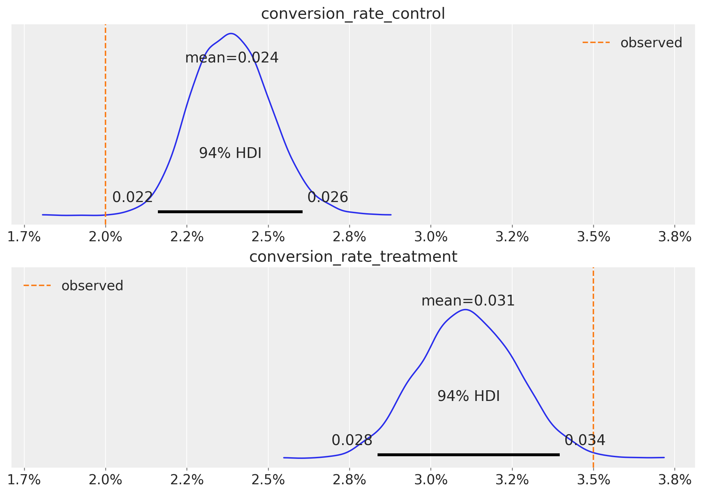{fig-align="center" width="420"}

:::
::::

::: footer
[Prior Predictive Modeling in Bayesian A/B Testing](https://juanitorduz.github.io/prior_predictive_ab_testing/)
:::

## Confounders: An Example {.smaller}

We use the LaLonde data from a job training program (National Supported Work Demonstration, 1970s). We ask whether job training increases earnings.

:::: {.columns}
::: {.column width="60%"}

- **Treatment:** participation in the job training program (`treat`).
- **Outcome:** earnings in 1978 (`re78`, in thousands of USD).
- **Covariates:** education, age, earnings in 1975 (`re75`), race and ethnicity, marital status, degree.
- **Naive comparison:** the treated group earned $635$ USD less than the comparison group. But the comparison group comes from an observational survey, so treatment was not randomly assigned.

:::
::: {.column width="40%"}

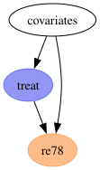{fig-align="center" width="200"}

::: {.callout-note appearance="simple"}
We assume that the covariates block every backdoor path (the **backdoor criterion**).
:::

:::
::::

::: footer
[Introduction to Causal Inference with PPLs](https://juanitorduz.github.io/intro_causal_inference_ppl_pymc/)
:::

## ATE Estimation Strategies {.smaller}

We have two ways to estimate the ATE:

1. We fit a linear regression and read the estimate of $\beta_{\text{treat}}$ as the ATE:

    $$
    \text{earnings} = \alpha + \beta_{\text{treat}} \cdot \text{treat} + \beta_{\text{covariates}}^{\top} \text{covariates} + \varepsilon
    $$

2. We use the `do` operator:

    $$
    \text{ATE} = \text{E}[\text{earnings} \mid \text{do}(\text{treat} = 1)] - \text{E}[\text{earnings} \mid \text{do}(\text{treat} = 0)]
    $$

::: {.callout-note}

## Pearl's `do` Operator

$\text{P}(Y \mid \text{do}(T = t))$ is the distribution of $Y$ when we **set** $T = t$ for every unit. In the graph, it cuts all arrows into $T$, as in a randomized experiment.

:::

::: footer
[Introduction to Causal Inference with PPLs](https://juanitorduz.github.io/intro_causal_inference_ppl_pymc/)
:::

## PyMC Model: Treatment Sub-model {.smaller}

The first part of the model encodes the arrows from the covariates to `treat`.

```{.python code-line-numbers="|1|2-5|7-11|13-17|19-20"}
with pm.Model(coords=coords) as earnings_model:
    # --- Data ---
    covariates_data = pm.Data(
        "covariates_data", covariates_obs, dims=("obs_idx", "covariate")
    )

    # --- Priors ---
    intercept_treat = pm.Normal("intercept_treat", mu=0, sigma=10)
    beta_covariate_treat = pm.Normal(
        "beta_covariate_treat", mu=0, sigma=1, dims=("covariate",)
    )

    # --- Parametrization ---
    logit_p_treat = intercept_treat + pm.math.dot(
        covariates_data, beta_covariate_treat
    )
    p_treat = pm.math.sigmoid(logit_p_treat)

    # --- Likelihood ---
    treat = pm.Bernoulli("treat", p=p_treat, dims=("obs_idx",))
```

::: footer
[Introduction to Causal Inference with PPLs](https://juanitorduz.github.io/intro_causal_inference_ppl_pymc/)
:::

## PyMC Model: Earnings Sub-model {.smaller}

The second part encodes the arrows from `treat` and the covariates to earnings.

```{.python code-line-numbers="|1-7|9-15|17-20"}
    # --- Priors ---
    intercept_earnings = pm.Normal("intercept_earnings", mu=0, sigma=10)
    beta_treat_earnings = pm.Normal("beta_treat_earnings", mu=0, sigma=1)
    beta_covariate_earnings = pm.Normal(
        "beta_covariate_earnings", mu=0, sigma=1, dims=("covariate",)
    )
    sigma_earnings = pm.HalfNormal("sigma_earnings", sigma=10.0)

    # --- Parametrization ---
    mu_earnings = pm.Deterministic(
        "mu_earnings",
        intercept_earnings + beta_treat_earnings * treat
            + pm.math.dot(covariates_data, beta_covariate_earnings),
        dims=("obs_idx",),
    )

    # --- Likelihood ---
    pm.Normal(
      "earnings", mu=mu_earnings, sigma=sigma_earnings, dims=("obs_idx",)
    )
```

::: footer
[Introduction to Causal Inference with PPLs](https://juanitorduz.github.io/intro_causal_inference_ppl_pymc/)
:::

## Conditioning on Observed Data

We condition the generative model on the observed treatment and earnings. The same program now defines the likelihood.

```{.python}
conditioned_earnings_model = observe(
    earnings_model, {"treat": training_obs, "earnings": earnings_obs}
)
```

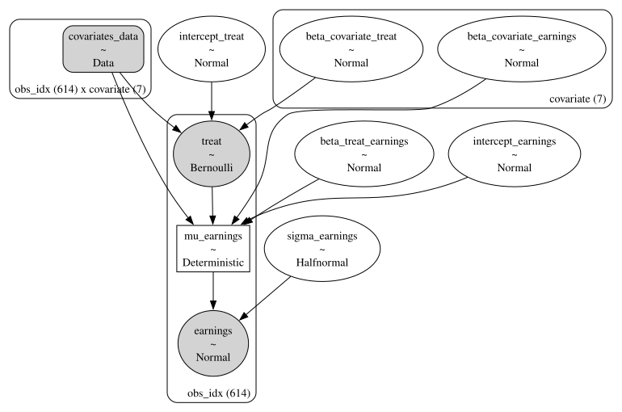{fig-align="center" width="700"}

::: footer
[Introduction to Causal Inference with PPLs](https://juanitorduz.github.io/intro_causal_inference_ppl_pymc/)
:::

## ATE from the Regression Coefficient {.smaller}

In the linear model, the posterior of `beta_treat_earnings` is the ATE: mean $0.55$ (about $550$ USD) with $94\%$ highest density interval (HDI) $[-0.55, 1.7]$.

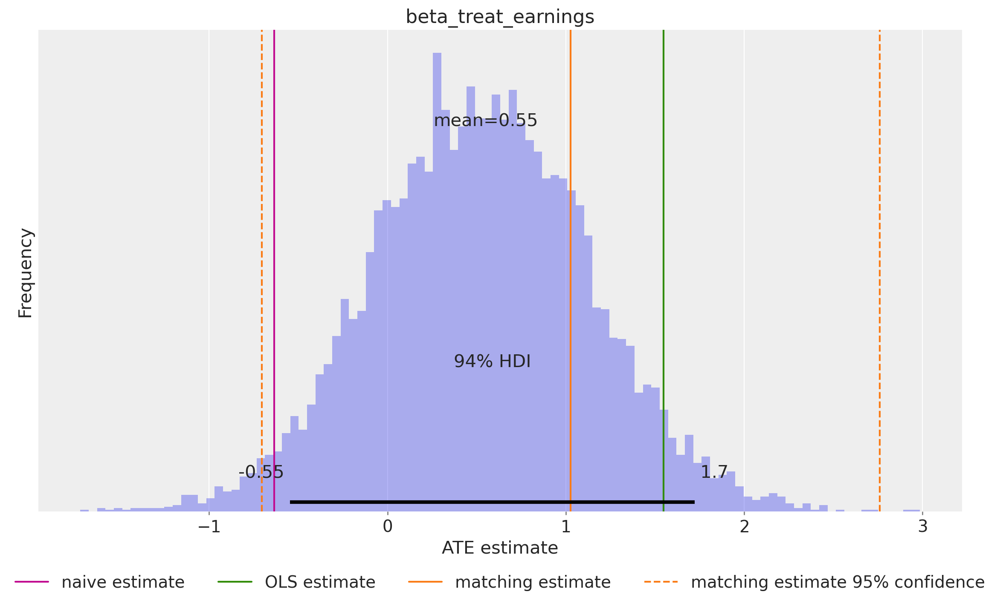{fig-align="center" width="800"}

The vertical lines show the naive difference and the OLS and matching estimates from an [external analysis](https://rugg2.github.io/Lalonde%20dataset%20-%20Causal%20Inference.html). That analysis also adjusts for 1974 earnings (`re74`), which our model leaves out.

::: footer
[Introduction to Causal Inference with PPLs](https://juanitorduz.github.io/intro_causal_inference_ppl_pymc/)
:::

## The `do` Operator {.smaller}

We set `treat` to $0$ and to $1$ for every unit. The arrows from the covariates into `treat` disappear from the graph.

```{.python code-line-numbers="|1|2-4"}
from pymc.model.transform.conditioning import do
# Counterfactual interventions
do_0_model = do(conditioned_earnings_model, {"treat": np.zeros(n_obs)})
do_1_model = do(conditioned_earnings_model, {"treat": np.ones(n_obs)})
```

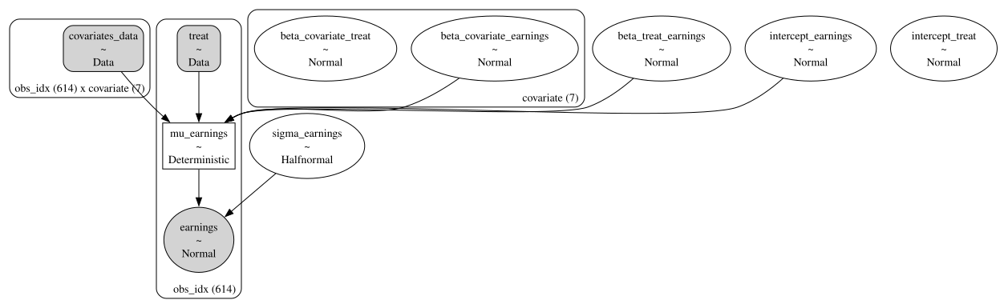{fig-align="center" width="1000"}

In NumPyro, the `numpyro.handlers.do` effect handler does the same.

::: footer
[Introduction to Causal Inference with PPLs](https://juanitorduz.github.io/intro_causal_inference_ppl_pymc/)
:::

## Counterfactual Predictions {.smaller}

:::: {.columns}
::: {.column width="50%"}

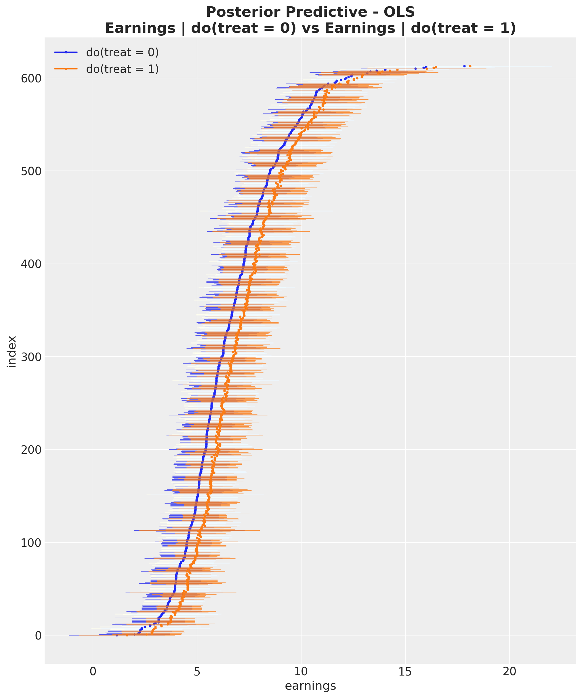{fig-align="center" width="340"}

:::

::: {.column width="50%"}

For each unit, we predict earnings under $\text{do}(\text{treat} = 0)$ and $\text{do}(\text{treat} = 1)$. The ATE is the average of the differences.

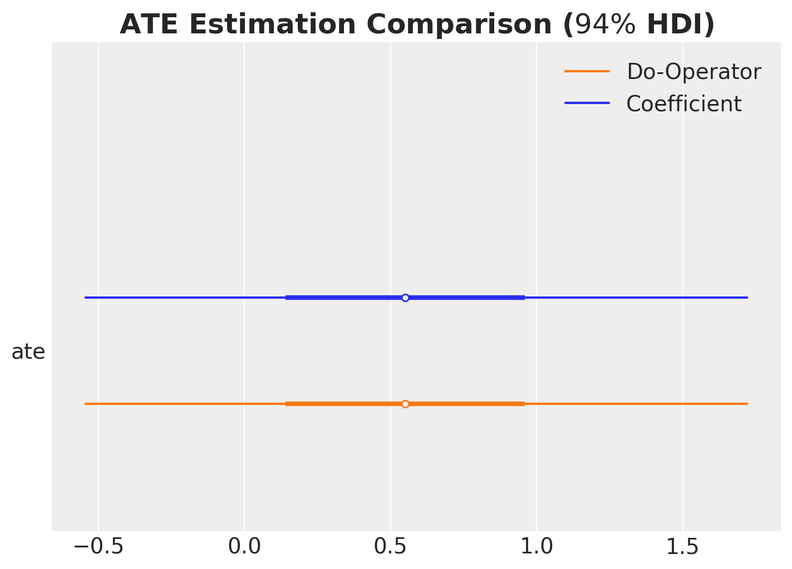{fig-align="center" width="400"}

In the linear model, the `do` operator and the regression coefficient give the **same** ATE, which is good!

:::
::::

::: footer
[Introduction to Causal Inference with PPLs](https://juanitorduz.github.io/intro_causal_inference_ppl_pymc/)
:::

## A Gamma GLM {.smaller}

:::: {.columns}
::: {.column width="55%"}

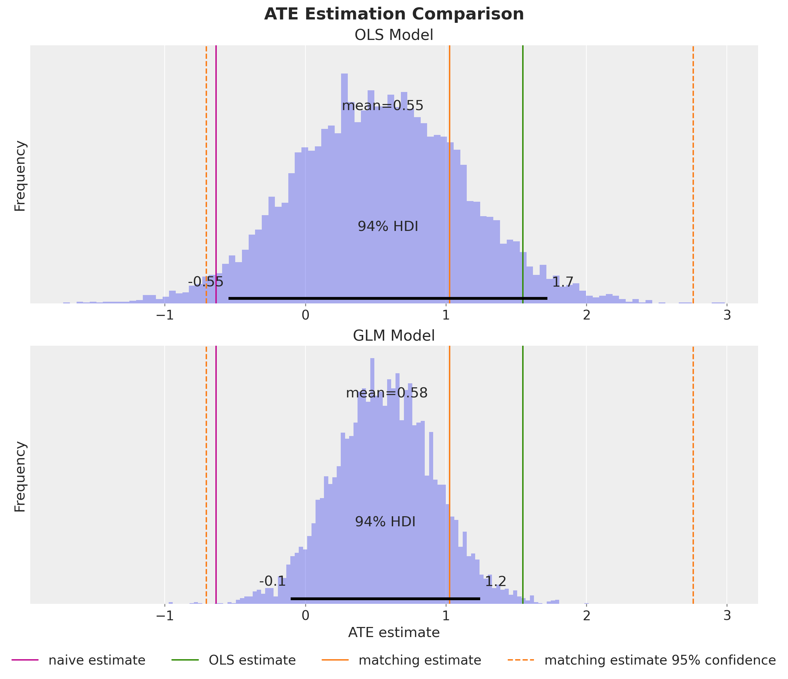{fig-align="center" width="560"}

:::
::: {.column width="45%"}

- Earnings are non-negative and right-skewed.
- We change two lines: a softplus link keeps the mean positive, and `pm.Gamma` replaces `pm.Normal`.
- With a non-linear link, the coefficient is **not** the ATE.
- The `do` operator still gives the ATE on the original scale: mean $0.58$ with $94\%$ HDI $[-0.1, 1.2]$.

::: {.callout-tip appearance="simple"}
The same `do` code works for non-linear links and for individual counterfactuals.
:::

:::
::::

::: footer
[Introduction to Causal Inference with PPLs](https://juanitorduz.github.io/intro_causal_inference_ppl_pymc/)
:::

## Marketing Mix Models {.smaller}

:::: {.columns}
::: {.column width="45%"}

::: {.callout-tip appearance="simple"}
How should we split next quarter's marketing budget across channels (TV, radio, search, and so on) to maximize sales?
:::

We need the causal effect of each channel $m$ on sales $y$. A marketing mix model (MMM) splits sales into a baseline, seasonality, and channel contributions.

:::
::: {.column width="55%"}

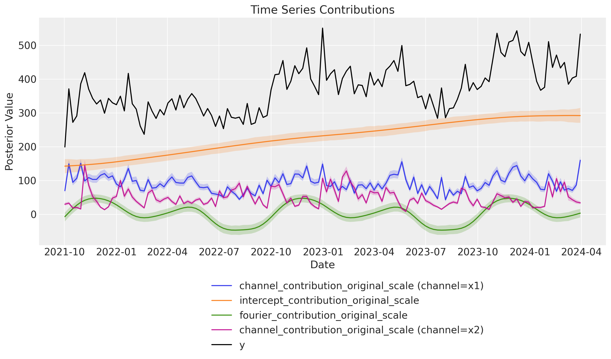{fig-align="center" width="500"}

:::
::::

A common summary is the **return on ad spend (ROAS)**:

$$
\text{ROAS}_m = \frac{\sum_t \left(\text{E}[y_t \mid \text{do}(x_m = x_m^{\text{obs}})] - \text{E}[y_t \mid \text{do}(x_m = 0)]\right)}{\sum_t x_{m,t}}
$$

The ROAS is an ATE per unit of spend (a continuous treatment that was not randomized).

::: footer
[PyMC-Marketing](https://www.pymc-marketing.io/)
:::

## MMM as a Regression Model

$$
y_{t} = b_{t} + \sum_{m=1}^{M}\beta_{m, t}f(x_{m, t}) +  \sum_{c=1}^{C}\gamma_{c}z_{c, t} + \varepsilon_{t},
$$

::: {.callout-note appearance="minimal"}
- $y_{t}$: target variable at time $t$ (for example, sales or conversions)
- $b_{t}$: baseline sales at time $t$
- $\beta_{m, t}$: effect of media channel $m$ on sales at time $t$
- $f(x_{m, t})$: transformation of the spend $x_{m, t}$ on channel $m$ at time $t$
- $\gamma_{c}$: effect of control variable $z_{c, t}$ on sales
- $\varepsilon_{t}$: error term
:::

::: footer
[Jin, Yuxue, et al. "Bayesian methods for media mix modeling with carryover and shape effects." (2017).](https://research.google/pubs/pub46001/)
:::

## Adstock and Saturation {.smaller}

:::: {.columns}
::: {.column width="50%"}

The **adstock** transformation models carryover: the effect of an ad persists and decays over time.

$$
\text{adstock}(x_{m, t}; \alpha, L) = \sum_{j=0}^{L} \alpha^{j} x_{m, t-j}
$$

for $\alpha \in [0, 1]$ and $L$ the maximum lag.

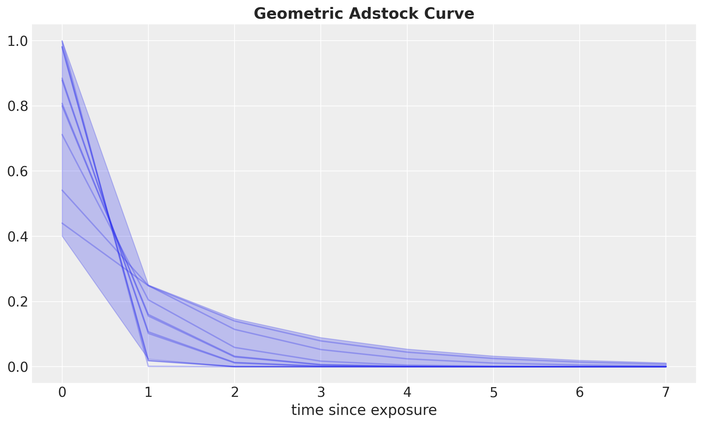{fig-align="center" width="410"}

:::
::: {.column width="50%"}

The **saturation** transformation models diminishing returns: each extra unit of spend has a smaller effect.

$$
\text{saturation}(x_{m, t}; \lambda) = \frac{1 - \exp(-\lambda x_{m, t})}{1 + \exp(-\lambda x_{m, t})}
$$

for $\lambda > 0$.

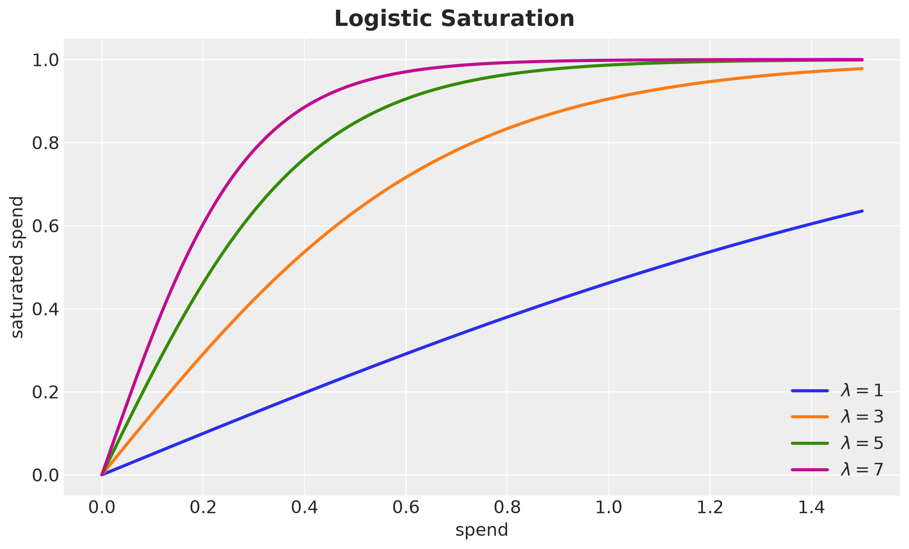{fig-align="center" width="410"}

:::
::::

::: footer
[Jin, Yuxue, et al. "Bayesian methods for media mix modeling with carryover and shape effects." (2017).](https://research.google/pubs/pub46001/)
:::

## Why Bayesian MMMs? {.smaller}

### Some MMM Challenges

::: incremental

- Limited data: typically $2$ to $3$ years of weekly data.

- Media spend series are often highly correlated.

- Unobserved confounders (for example, competitor activity).

:::

### Bayesian MMMs

::: incremental

- Uncertainty quantification.

- Domain knowledge through priors.

- Calibration with experiments (lift tests).

- Time-varying parameters with regularization (strong priors or hierarchies).

- Budget optimization that accounts for uncertainty.

:::

## Unobserved Confounders {.smaller}

:::: {.columns}
::: {.column width="45%"}

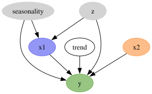{fig-align="center" width="420"}

:::
::: {.column width="55%"}

We simulate $2.5$ years of weekly data with two channels, `x1` and `x2`, and sales `y`.

- `z` is a confounder: it drives the spend on `x1` and the sales `y`.
- The models include trend and seasonality. If we leave out `z`, the backdoor path through `z` stays open.
- **Model 1** includes `z`. **Model 2** leaves `z` out, as if we could not observe it.
- We know the true ROAS of each channel because we simulate the data.

:::
::::

::: {.callout-important appearance="simple"}
This is the job training example again, but now we cannot adjust for the confounder.
:::

::: footer
[Media Mix Model and Experimental Calibration: A Simulation Study](https://juanitorduz.github.io/mmm_roas/)
:::

## Biased ROAS {.smaller}

A model without `z` estimates a ROAS of $198$ for `x1` against a true value of $93$, and $142$ for `x2` against a true value of $171$. It ranks `x1` above `x2`. The truth is the opposite.

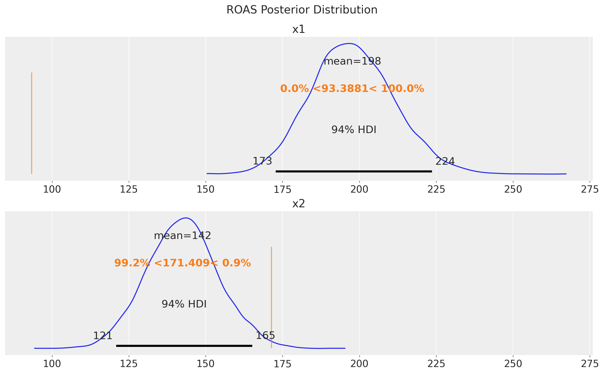{fig-align="center" width="600"}

::: {.callout-tip appearance="simple"}
How can we correct this? We bring experimental results into the model, in one of two ways: priors on the ROAS (Zhang et al., 2024) or an additional likelihood for lift tests, which are experiments on one channel (PyMC-Marketing).
:::

::: footer
[PyMC-Marketing: Mitigating Unobserved Confounders in MMMs with Lift Test Likelihoods](https://www.pymc-marketing.io/en/stable/notebooks/mmm/mmm_roas.html)
:::

## ROAS Re-parametrization {.smaller}

This is the same idea as the correlated priors in the A/B test: we put the prior on the quantity we know something about.

:::: {.columns}
::: {.column width="50%"}

We write each media coefficient as a function of the channel's ROAS:

$$
\beta_m = \frac{\text{ROAS}_m \sum_{t} x_{m,t}}{\sum_{t} \left(f(x_{m,t}) - f(\tilde{x}_{m,t})\right)}
$$

where $f$ is the media transformation (adstock and saturation) and $\tilde{x}_{m}$ is the spend with channel $m$ turned off.

:::
::: {.column width="50%"}

Now we can put a prior on the ROAS of each channel, for example from a past experiment. In the simulation, we center the priors at $95$ and $170$, close to the truth (shown below on the scaled data).

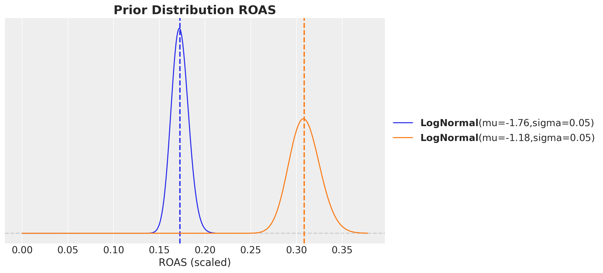{fig-align="center" width="480"}

:::
::::

::: footer
[Zhang et al. (2024)](https://research.google/pubs/media-mix-model-calibration-with-bayesian-priors/) and [Media Mix Model and Experimental Calibration: A Simulation Study](https://juanitorduz.github.io/mmm_roas/)
:::

## ROAS Priors: Model Comparison {.smaller}

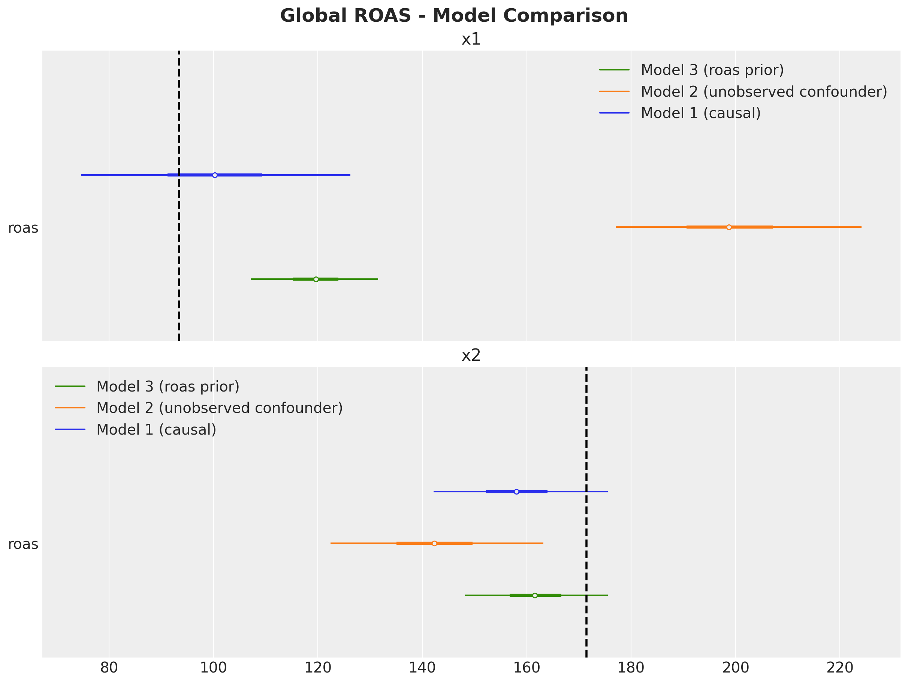{fig-align="center" width="560"}

Model 3 has ROAS priors and still leaves out `z`. It moves the ROAS of `x1` from about $200$ to about $120$. The bias shrinks, but it does not go away. The posterior balances the prior and the evidence from the data.

::: footer
[Media Mix Model and Experimental Calibration: A Simulation Study](https://juanitorduz.github.io/mmm_roas/)
:::

## Lift Test Calibration {.smaller}

::: {.callout-tip appearance="simple"}
A **lift test** is an A/B test on one channel. We change the spend in some regions or time periods and measure the change in sales.
:::

:::: {.columns}
::: {.column width="58%"}

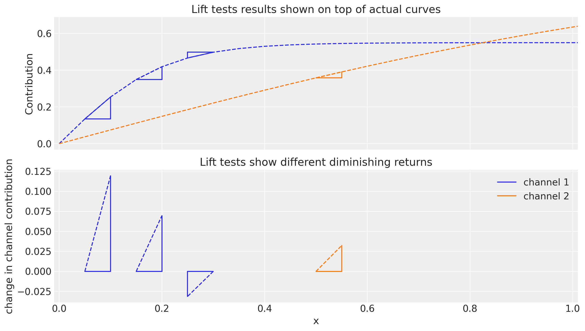{fig-align="center" width="560"}

:::
::: {.column width="42%"}

- Each test measures how much the saturation curve rises from $x$ to $x + \Delta x$.
- The model predicts this lift from the curve. The measured lift enters as an **additional likelihood**.
- The saturation parameters must explain the sales and the experiments.
- Each new test adds one more observation.

:::
::::

::: footer
[PyMC-Marketing: Lift Test Calibration](https://www.pymc-marketing.io/en/stable/notebooks/mmm/mmm_lift_test.html)
:::

## Lift Test Calibration: Results {.smaller}

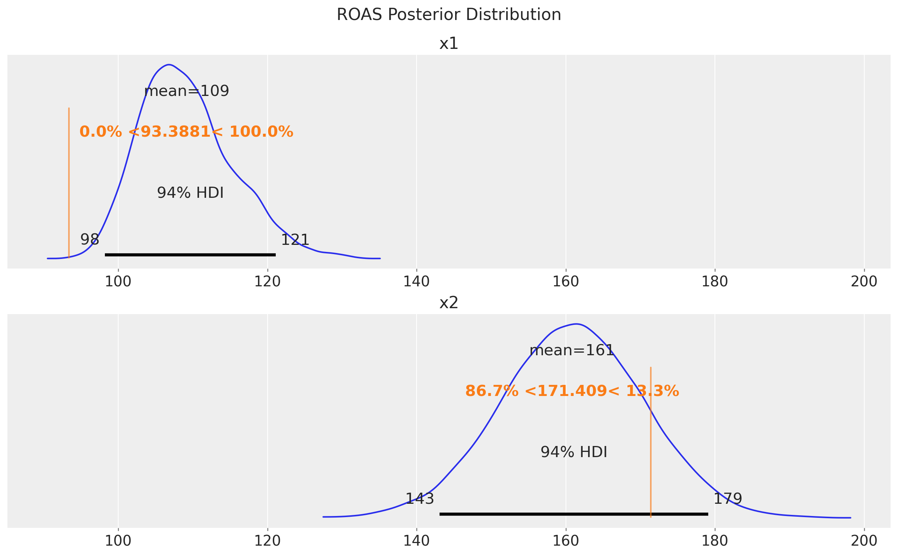{fig-align="center" width="600"}

With lift tests and still without `z`, the ROAS of `x1` moves from $198$ to $109$ ($94\%$ HDI $[98, 121]$, true value $93$). For `x2`, we get $161$ ($94\%$ HDI $[143, 179]$, true value $171$). The bias on `x1` drops from $+112\%$ to $+17\%$, and the ranking of the two channels is now correct.

::: footer
[PyMC-Marketing: Mitigating Unobserved Confounders in MMMs with Lift Test Likelihoods](https://www.pymc-marketing.io/en/stable/notebooks/mmm/mmm_roas.html)
:::

## Funnel Models in Marketing {.smaller}

So far, the bias came from a variable we left out. Now it can come from one we put in. We use the PyMC-Marketing MMM case study: $209$ weeks of synthetic sales data.

:::: {.columns}
::: {.column width="50%"}

- **Upper funnel** channels build awareness: `TV`, `Radio`, `Newspaper`.
- **Lower funnel** channels capture existing demand, for example paid search (`sem_spend`).
- Paid search is $26.9\%$ of media spend. Should it be one more channel?
- Paid search spend and impressions (how often the ads show) both correlate with sales ($0.59$).

:::
::: {.column width="50%"}

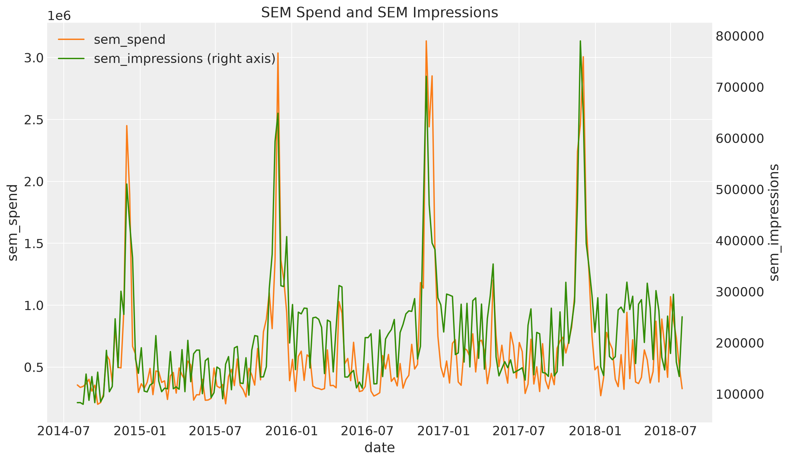{fig-align="center" width="480"}

:::
::::

::: {.callout-important appearance="simple"}
Two stories fit the data: paid search drives sales, or paid search harvests demand that the upper funnel created. Correlation cannot separate them.
:::

::: footer
[PyMC-Marketing: MMM Case Study II](https://www.pymc-marketing.io/en/stable/notebooks/mmm/mmm_case_study2.html)
:::

## The Funnel DAG {.smaller .nostretch}

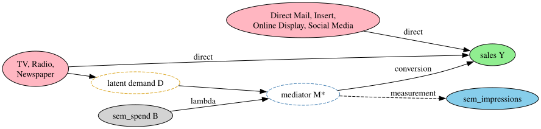{fig-align="center" width="800"}

- `TV`, `Radio`, and `Newspaper` act on sales directly and through **latent demand** $D$.
- The paid search budget $B$ adds to $D$. The sum is the **mediator** $M^*$: the demand that paid search reaches. Here $B$ is exogenous.
- Search impressions measure $M^*$. They do not cause sales. Dashed nodes are latent.
- In practice, paid search spend also follows demand. Then a model with paid search as one more channel conditions on the mediator and credits paid search with sales that the upper funnel created. [Chan and Perry (2017)](https://storage.googleapis.com/gweb-research2023-media/pubtools/3803.pdf): *"Downstream ads should not be included with exogenously-determined ads in a single regression equation."*

::: footer
[PyMC-Marketing: MMM Case Study II](https://www.pymc-marketing.io/en/stable/notebooks/mmm/mmm_case_study2.html)
:::

## Funnel Model Structure {.smaller}

Let $U_{t,c}$ be the spend of upper funnel channel $c$ in week $t$, $B_t$ the paid search spend, and $I_t$ the search impressions:

$$
\begin{align*}
D_t & = \text{baseline} + \sum_{c \in \text{upper}} \text{sat}^{uf}\left(\text{adstock}^{uf}(U_{t,c})\right) \\
M^{*}_t & = D_t + \lambda \, \frac{B_t}{s_{B}} \\
I_t & \sim \text{TruncatedNormal}\left(s_{I} \, M^{*}_t, \sigma_{I}, \text{lower}=0\right)
\end{align*}
$$

Sales get the extra term $\text{sat}^{lf}\left(\text{adstock}^{lf}(M^{*}_t)\right)$. The parameter $\lambda$ converts paid search spend into search demand, and $s_{B}$, $s_{I}$ are the maxima of the two series.

::: {.callout-note}

## A Structural Equation Model

This is a structural equation model with a latent variable. The impressions equation is the **measurement model**. We fix its loading at one (on $I_t / s_I$) to set the scale of $M^*$.

:::

::: footer
[PyMC-Marketing: MMM Case Study II](https://www.pymc-marketing.io/en/stable/notebooks/mmm/mmm_case_study2.html)
:::

## Direct and Mediated Contributions {.smaller}

:::: {.columns}
::: {.column width="55%"}

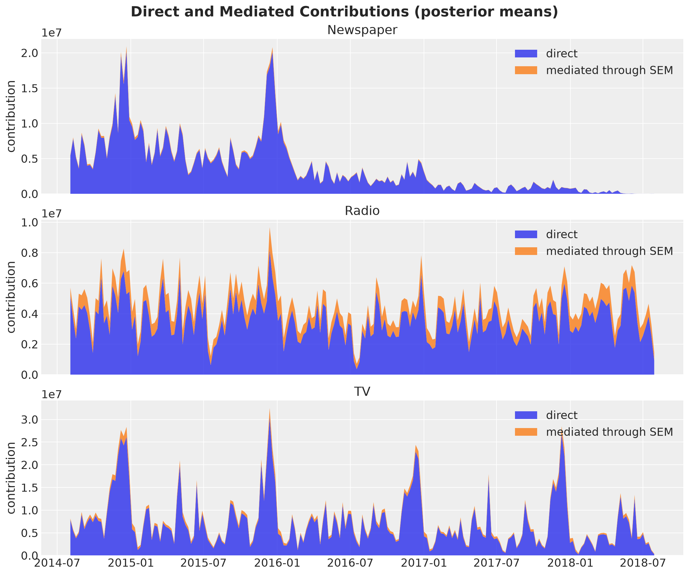{fig-align="center" width="520"}

:::
::: {.column width="45%"}

- We compute the mediated part with the `do` operator: we set the spend of one upper funnel channel to zero and push the change through $D$ and $M^*$ to sales.
- The mediated share of each channel's total effect is about $6\%$ (`Newspaper`), $12\%$ (`TV`), and $25\%$ (`Radio`). The lower ends of the $94\%$ HDIs reach zero.
- Why so small? About $41\%$ of the mediator comes from the baseline and $49\%$ from paid search's own spend. Only about $10\%$ comes from upper funnel media.

:::
::::

::: footer
[PyMC-Marketing: MMM Case Study II](https://www.pymc-marketing.io/en/stable/notebooks/mmm/mmm_case_study2.html)
:::

## Structure and Experiments Together {.smaller}

We compare the ROAS (mean and $94\%$ HDI) of two models. **Part I** is the MMM from the first part of the case study, without paid search, funnel, or calibration. **Part II** is the funnel model plus two hypothetical experiments.

::: {style="font-size: 75%;"}

| Role         | Channel          | Part I                   | Part II                 |
|:-------------|:-----------------|:-------------------------|:------------------------|
| Calibrated   | `Online Display` | $56.4 \; [0.8, 118.8]$   | $27.9 \; [21.1, 35.1]$  |
| Calibrated   | `Direct Mail`    | $7.3 \; [0.0, 19.5]$     | $4.7 \; [2.0, 7.3]$     |
| Upper funnel | `TV`             | $43.6 \; [0.7, 86.0]$    | $45.7 \; [3.6, 92.8]$   |
| Upper funnel | `Radio`          | $32.1 \; [0.0, 84.7]$    | $35.7 \; [1.8, 85.2]$   |
| Upper funnel | `Newspaper`      | $14.4 \; [0.2, 30.1]$    | $14.9 \; [0.4, 32.0]$   |
| Control      | `Insert`         | $55.9 \; [0.1, 125.9]$   | $57.6 \; [0.4, 141.6]$  |
| Control      | `Social Media`   | $30.7 \; [0.2, 74.0]$    | $26.8 \; [0.1, 67.4]$   |

:::

The experiments shrink the `Online Display` interval to $12\%$ of its former width. The upper funnel channels now report the total effect. The control channels barely move.

::: {.callout-warning appearance="simple"}
Match the calibration target to the estimand of the experiment. The calibration constrains the **direct** effect, which is valid because the calibrated channels have no funnel path.
:::

::: footer
[PyMC-Marketing: MMM Case Study II](https://www.pymc-marketing.io/en/stable/notebooks/mmm/mmm_case_study2.html)
:::

## Causal Identification in Funnel Models {.smaller .nostretch}

The case study has no ground truth. So we simulate a funnel from the funnel model itself, with the true parameters fixed via `pm.do`. Now paid search spend responds to demand.

- $3$ geos (regions), $130$ weeks, and two upper funnel channels.
- **Mediator:** paid search spend `lower_spend` measures the latent $M^*$. Only its budget is exogenous.
- **Indicator:** branded search `search_volume` measures latent demand $D$. It does not cause sales.
- **Confounding:** media plans and category demand share seasonality, trend, and noise.

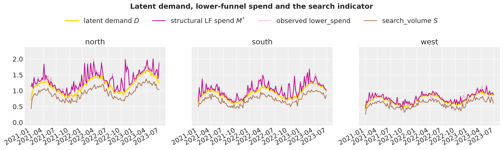{fig-align="center" width="620"}

::: footer
[PyMC-Marketing: Advanced Funnel-Aware MMM](https://www.pymc-marketing.io/en/stable/notebooks/mmm/mmm_funnel_mueffect_advanced.html)
:::

## The Causal DAG {.smaller}

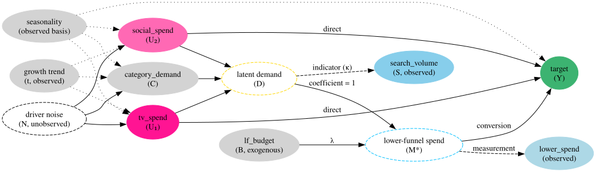{fig-align="center" width="1000"}

- **Mediator or indicator?** We ask: "if we doubled this variable, would sales move?" Lower funnel spend: yes, so it is a mediator. Branded search: no, so it is an indicator.
- **Exclusion restrictions:** the budget $B$ enters $M^*$ but not $S$. This identifies $\lambda$. Category demand $C$ enters $D$ but not $Y$.
- The driver noise $N$ is unobserved. It confounds `tv_spend`, `social_spend`, and category demand.

::: footer
[PyMC-Marketing: Advanced Funnel-Aware MMM](https://www.pymc-marketing.io/en/stable/notebooks/mmm/mmm_funnel_mueffect_advanced.html)
:::

## Which Models Identify What? {.smaller}

We use the DAG to check which conditioning sets satisfy the backdoor criterion for the **total** effect of `tv_spend` ($U_1$) on sales. There are $43$ backdoor paths from $U_1$ to $Y$.

| Model                   | Conditions on            | Valid for the total effect?          |
|:------------------------|:-------------------------|:-------------------------------------|
| A: mediator as channel  | $M$, $U_2$, season       | No: $M$ is a descendant of $U_1$     |
| B: mediator omitted     | $U_2$, season            | No: $4$ backdoor paths stay open      |
| B+: demand as control   | $C$, $U_2$, season       | **Yes**: all backdoor paths blocked  |
| B++: trend as control   | $t$, $U_2$, season       | No: $1$ backdoor path stays open      |
| C: indicator as channel | $S$, $U_2$, season       | No: $S$ is a descendant of $U_1$     |
| Funnel model            | models $D$, $M^*$, $S$   | Relies on the structural equations   |

::: {.callout-note appearance="simple"}
B++ leaves the path $U_1 \leftarrow N \to C \to D \to M^* \to Y$ open because the noise $N$ is unobserved. We run these checks with `networkx` on the same edge list that draws the DAG.
:::

::: footer
[PyMC-Marketing: Advanced Funnel-Aware MMM](https://www.pymc-marketing.io/en/stable/notebooks/mmm/mmm_funnel_mueffect_advanced.html)
:::

## Testable and Untestable Assumptions {.smaller}

::: {.callout-warning}

## Untestable

The funnel model is correct only if the demand equation is right and nothing unobserved confounds $M^* \to Y$. Neither the backdoor checks nor the posterior predictive checks can reveal a violation.

:::

::: {.callout-tip}

## Testable

The DAG implies that the budget $B$ and branded search $S$ are independent ($B \perp S$), but not given $Y$ or $M$. In the data, the correlations per geo are $-0.070$, $+0.046$, and $-0.101$, against a standard error of about $0.09$. The data does not contradict the DAG.

:::

::: {.callout-note}

## A Fair Comparison

Here, the funnel model is the true data-generating process. It also sees two more series than the naive models. The gain comes from structure and information together.

:::

::: footer
[PyMC-Marketing: Advanced Funnel-Aware MMM](https://www.pymc-marketing.io/en/stable/notebooks/mmm/mmm_funnel_mueffect_advanced.html)
:::

## ROAS by Model {.smaller}

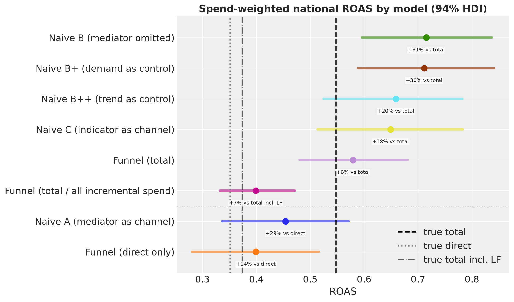{fig-align="center" width="680"}

Against the true total ROAS, the four naive models that target the total effect overstate the national ROAS by $18\%$ to $31\%$. The funnel model is $6\%$ above the truth. Even the valid adjustment set (B+) overstates it by $30\%$.

::: footer
[PyMC-Marketing: Advanced Funnel-Aware MMM](https://www.pymc-marketing.io/en/stable/notebooks/mmm/mmm_funnel_mueffect_advanced.html)
:::

## Fit Does Not Rank Causal Models {.smaller}

::: incremental

- The in-sample $R^2$ of the six models ranges from $0.979$ to $0.987$. Their ROAS estimates differ by tens of percent.
- Why does the valid adjustment set (B+) still fail? It overstates the ROAS of `social_spend` by $100\%$ in `south` and $40\%$ in `west`. In `south`, every model overstates `social_spend`, the funnel model included ($+27\%$).
- Category demand enters B+ as a linear control, while the media effects are flexible curves. The media curves absorb part of the demand effect. On `tv_spend`, the invalid set B++ ($4.4\%$ mean error) beats the valid set B+ ($15.3\%$).

:::

> A valid adjustment set says which variables you need, not how they enter the model or which structure is missing.
>
> [Advanced Funnel-Aware MMM](https://www.pymc-marketing.io/en/stable/notebooks/mmm/mmm_funnel_mueffect_advanced.html)

::: footer
[PyMC-Marketing: Advanced Funnel-Aware MMM](https://www.pymc-marketing.io/en/stable/notebooks/mmm/mmm_funnel_mueffect_advanced.html)
:::

## Takeaways

::: {.callout-tip}

## Causal Inference with PPLs

- **The model states the assumptions.** We write the DAG as code: job training, MMM, and funnel models.
- **Priors carry outside information.** Domain knowledge rules out implausible lifts in A/B tests. Experiments reduce, but do not remove, confounding bias in MMMs.
- **The same `do` query works across models.** It applies to a linear regression, a Gamma GLM, and a funnel model with latent demand.
- **Latent variables and measurements are part of the model.** The funnel models treat search impressions and branded search as measurements of latent variables, not as causes.
- **Identification comes first.** The DAG tells us what we can estimate and which assumptions we need. A good in-sample fit does not replace them.

:::

## PyMC-Marketing

{fig-align="center" width="1000"}

> Bayesian marketing toolbox in PyMC. Media Mix (MMM), customer lifetime value (CLV), buy-till-you-die (BTYD) models and more.

::: footer
[PyMC-Marketing](https://www.pymc-marketing.io/)
:::

## References: Posts and Notebooks {.smaller}

::: {style="font-size: 85%;"}

:::: {.columns}
::: {.column width="70%"}

#### Blog Posts

- [Prior Predictive Modeling in Bayesian A/B Testing](https://juanitorduz.github.io/prior_predictive_ab_testing/)
- [Introduction to Causal Inference with PPLs](https://juanitorduz.github.io/intro_causal_inference_ppl_pymc/)
- [Media Mix Model and Experimental Calibration: A Simulation Study](https://juanitorduz.github.io/mmm_roas/)
- [Causal Effect Estimation with Variational Inference and Latent Confounders](https://juanitorduz.github.io/online_game_ate/) (NumPyro)

#### PyMC-Marketing Notebooks

- [Lift Test Calibration](https://www.pymc-marketing.io/en/stable/notebooks/mmm/mmm_lift_test.html)
- [Mitigating Unobserved Confounders in MMMs with Lift Test Likelihoods](https://www.pymc-marketing.io/en/stable/notebooks/mmm/mmm_roas.html)
- [MMM Case Study II: Funnel-Aware Modeling, ROAS Calibration, and Budget Planning](https://www.pymc-marketing.io/en/stable/notebooks/mmm/mmm_case_study2.html)
- [Advanced Funnel-Aware MMM: Geo-Level Mediation Through Lower-Funnel Spend](https://www.pymc-marketing.io/en/stable/notebooks/mmm/mmm_funnel_mueffect_advanced.html)

:::
::: {.column width="30%"}

#### Packages

- [CausalPy](https://causalpy.readthedocs.io/)
- [NumPyro](https://num.pyro.ai/)
- [PyMC](https://www.pymc.io/)
- [PyMC-Marketing](https://www.pymc-marketing.io/)

:::
::::

:::

## References: Papers and Books {.smaller}

::: {style="font-size: 85%;"}

#### Papers

- Rubin, D. B. (1974). [Estimating causal effects of treatments in randomized and nonrandomized studies.](https://doi.org/10.1037/h0037350) *Journal of Educational Psychology*.
- LaLonde, R. J. (1986). [Evaluating the econometric evaluations of training programs with experimental data.](https://www.jstor.org/stable/1806062) *American Economic Review*.
- Dehejia, R. H. & Wahba, S. (1999). [Causal effects in nonexperimental studies: reevaluating the evaluation of training programs.](https://doi.org/10.1080/01621459.1999.10473858) *Journal of the American Statistical Association*.
- Jin, Y. et al. (2017). [Bayesian methods for media mix modeling with carryover and shape effects.](https://research.google/pubs/pub46001/)
- Chan, D. & Perry, M. (2017). [Challenges and opportunities in media mix modeling.](https://storage.googleapis.com/gweb-research2023-media/pubtools/3803.pdf)
- Zhang, Y. et al. (2024). [Media mix model calibration with Bayesian priors.](https://research.google/pubs/media-mix-model-calibration-with-bayesian-priors/)

#### Books

- Pearl, J., Glymour, M. & Jewell, N. P. (2016). [*Causal Inference in Statistics: A Primer*.](http://bayes.cs.ucla.edu/PRIMER/)
- McElreath, R. (2020). [*Statistical Rethinking* (2nd ed.).](https://xcelab.net/rm/)

:::

## [Thank You!]{style="color: white;"} {background-image="hertie_2026_files/static/images/logos/pymc-labs-black.jpg"}

#### [juan.orduz@pymc-labs.com](mailto:juan.orduz@pymc-labs.com){style="color: white;"}

{.absolute top=400 right=-100 width=250 height=250}
