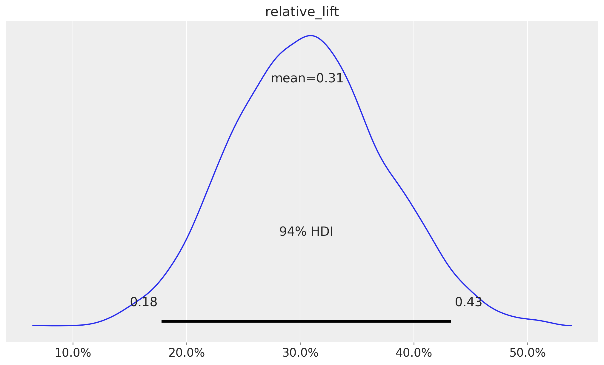
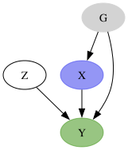
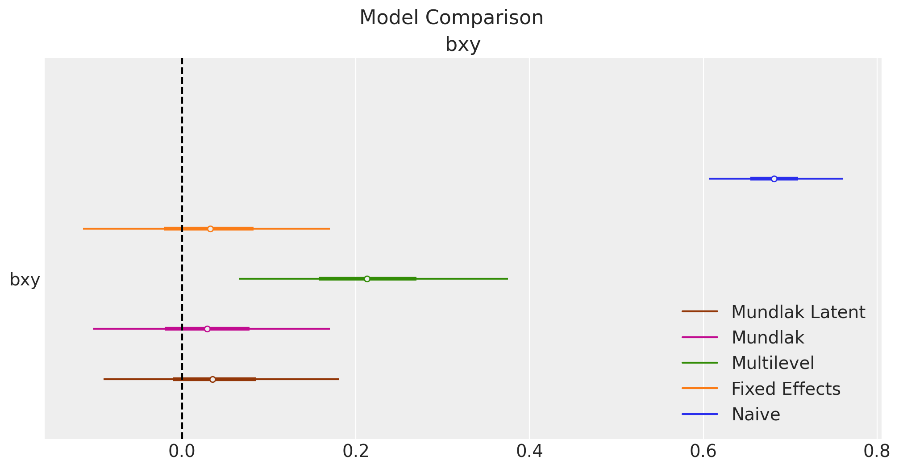
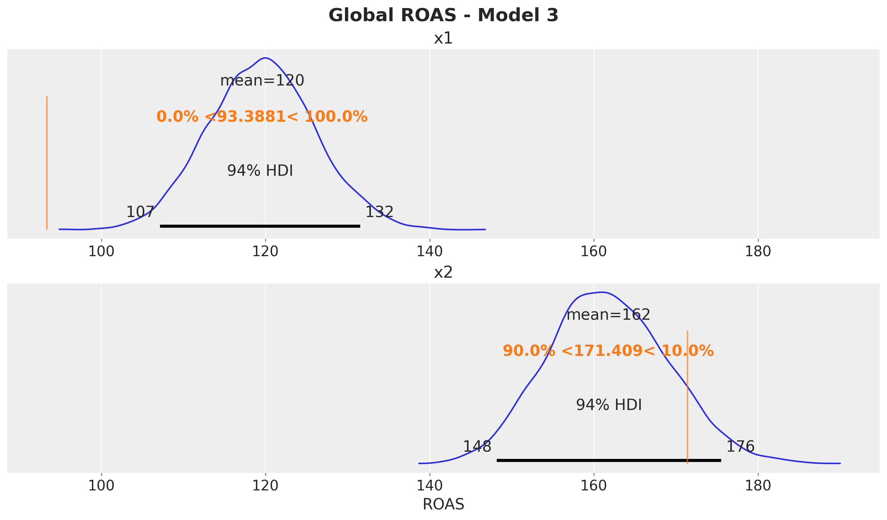
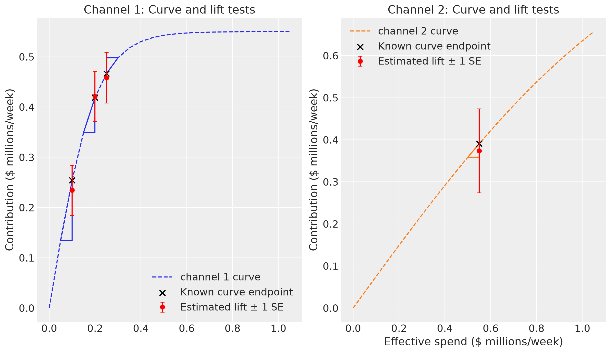
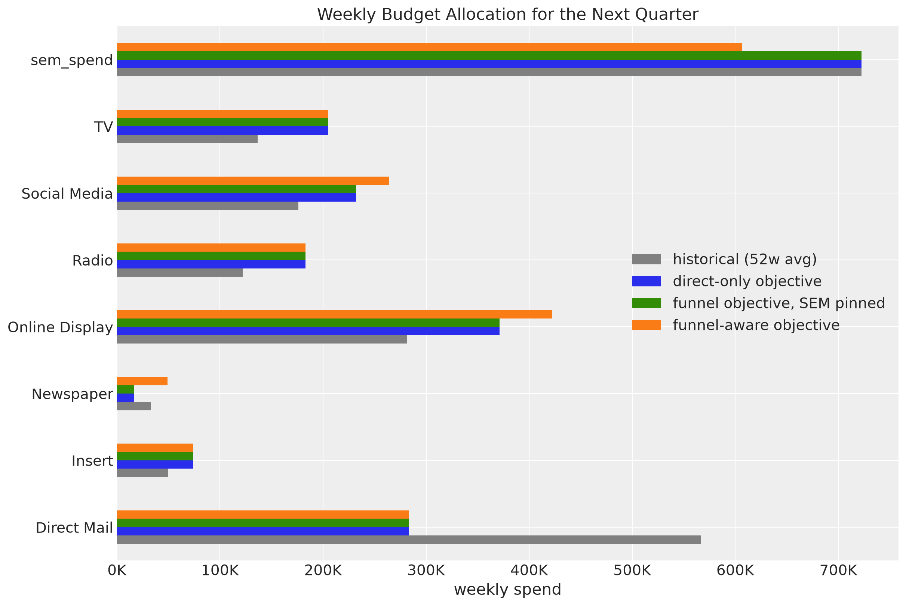

## Outline

:::: {.columns}
::: {.column width="50%"}

1. Causal Inference and PPLs
2. Bayesian A/B Testing
3. Regression and the `do` Operator
4. Hierarchical Models
5. Marketing Mix Models
6. Unobserved Confounders

:::

::: {.column width="50%"}

7. Calibration with Experiments
8. Funnel Models in Marketing
9. Budget Optimization
10. Takeaways
11. References

:::
::::

## Causal Inference {.smaller}

- **Goal:** Estimate the effect of a treatment $T$ on an outcome $Y$.
- **Potential outcomes** (Neyman, 1923; Rubin, 1974): for each unit $i$ there are two potential outcomes:
  - $Y_i(1)$: outcome if treated
  - $Y_i(0)$: outcome if not treated
- **Individual treatment effect:** $\tau_i = Y_i(1) - Y_i(0)$
- **Average treatment effect:** $\text{ATE} = \text{E}[Y(1) - Y(0)]$

::: {.callout-warning}

## The Fundamental Problem of Causal Inference

We never observe both $Y_i(1)$ and $Y_i(0)$ for the same unit. One potential outcome is always missing: the **counterfactual**.

$$
\text{Observed: } Y_i = T_i \cdot Y_i(1) + (1 - T_i) \cdot Y_i(0)
$$

A naive comparison of treated and untreated units can be biased because the two groups can differ in **confounders**.

:::

## Bayesian Statistics {.smaller}

We use Bayes' theorem to update our beliefs about parameters $\theta$ after we observe data $y$:

$$
\underbrace{p(\theta \mid y)}_{\text{posterior}} \propto \underbrace{p(y \mid \theta)}_{\text{likelihood}} \cdot \underbrace{p(\theta)}_{\text{prior}}
$$

::: incremental

- **Prior** $p(\theta)$: domain knowledge before we see the data.
- **Likelihood** $p(y \mid \theta)$: how probable the data is for given parameters.
- **Posterior** $p(\theta \mid y)$: updated beliefs after we see the data.

:::

::: {.callout-tip}
## From Generative Model to Inference

A probabilistic program describes how the data is generated. Before we observe data, every variable has a prior distribution. When we condition on observed data, the same program defines the likelihood. If we read its arrows as causal, the same program is both the causal model and the Bayesian model.
:::

::: {.callout-note}

## Probabilistic Programming Languages (PPLs)

PPLs let us write generative models as code and run posterior inference automatically. Examples: [PyMC](https://www.pymc.io/), [NumPyro](https://num.pyro.ai/), [Stan](https://mc-stan.org/).

:::

## Causal Inference and PPLs

::: {style="font-size: 92%;"}

In industry, we estimate causal effects from limited data and under assumptions we cannot fully test. PPLs help in the following ways:

::: {.callout-tip appearance="simple"}

- **The model is the DAG:** we write the data-generating process as code, so every causal assumption is explicit.
- **Priors:** domain knowledge and past experiments enter the estimate.
- **Uncertainty:** we get a posterior distribution for every causal quantity.
- **The `do` operator:** we apply interventions to the model and compute counterfactual predictions.
- **Flexible structure:** non-linear likelihoods, hierarchical models, latent variables, and measurement models.

:::

::: {.callout-warning appearance="simple"}
PPLs do not solve **identification**. They help with **estimation** once we state the causal assumptions.
:::

:::

## Bayesian A/B Testing {.smaller}

::: {.callout-tip appearance="simple"}
In an A/B test, we randomly assign users to a control group and a treatment group. Random assignment makes the treatment independent of all confounders, observed and unobserved. The hard part moves from identification to estimation under uncertainty. We observe $y_\text{c}$ and $y_\text{t}$ conversions out of $n$ users per group, and we add a Binomial likelihood for them later.
:::

```{.python code-line-numbers="|1|2-4|5-7|8-11|"}
with pm.Model() as non_informative_model:
    conversion_rate_control = pm.Uniform(
        "conversion_rate_control", lower=0, upper=1
    )
    conversion_rate_treatment = pm.Uniform(
        "conversion_rate_treatment", lower=0, upper=1
    )
    relative_lift = pm.Deterministic(
        "relative_lift",
        conversion_rate_treatment / conversion_rate_control - 1,
    )
```

:::: {.columns}
::: {.column width="65%"}

{fig-align="center" width="480"}

:::
::: {.column width="35%"}

\begin{align*}
\text{cr}_\text{c} & \sim \text{Beta}(1, 1) \\
\text{cr}_\text{t} & \sim \text{Beta}(1, 1) \\
\text{lift} & = \text{cr}_\text{t} / \text{cr}_\text{c} - 1
\end{align*}

:::
::::

::: footer
[Prior Predictive Modeling in Bayesian AB Testing](https://juanitorduz.github.io/prior_predictive_ab_testing/)
:::

## Independent Priors {.smaller}

:::: {.columns}
::: {.column width="50%"}

**Flat:** $\text{cr}_\text{c}, \text{cr}_\text{t} \sim \text{Beta}(1, 1)$

{fig-align="center" width="480"}

:::
::: {.column width="50%"}

**Informative:** $\text{cr}_\text{c}, \text{cr}_\text{t} \sim \text{Beta}(15, 600)$

{fig-align="center" width="480"}

:::
::::

::: {.callout-important}
## Independent priors give implausible lifts.

- The relative lift is a ratio of two random variables. Flat priors on the two conversion rates allow a treatment that is $100$ times better than control.
- Informative priors that put both rates near $2.4\%$ still allow lifts of $50\%$, which are rare in practice.
:::

::: footer
[Prior Predictive Modeling in Bayesian AB Testing](https://juanitorduz.github.io/prior_predictive_ab_testing/)
:::

## Correlated Priors {.smaller .nostretch}

Most lifts are small, so we set the prior on the **relative lift** itself.

:::: {.columns}
::: {.column width="55%"}

```{.python code-line-numbers="|2-4|5-7|8-11|"}
with pm.Model() as correlated_model:
    conversion_rate_control = pm.Beta(
        "conversion_rate_control", alpha=15, beta=600
    )
    relative_lift = pm.Normal(
        "relative_lift", mu=0, sigma=0.1
    )
    conversion_rate_treatment = pm.Deterministic(
        "conversion_rate_treatment",
        conversion_rate_control * (1 + relative_lift),
    )
```

{fig-align="center" width="380"}

:::
::: {.column width="45%"}

{fig-align="center" width="400"}

The joint prior of the two conversion rates concentrates on the diagonal.

:::
::::

::: footer
[Prior Predictive Modeling in Bayesian AB Testing](https://juanitorduz.github.io/prior_predictive_ab_testing/)
:::

## Inference with Correlated Priors {.smaller .nostretch}

We observe $200$ and $350$ conversions out of $10{,}000$ users per group (naive lift $75\%$).

```{.python code-line-numbers="|2|3"}
with correlated_model:
    pm.Binomial("n_control", n=n, p=conversion_rate_control, observed=n_c)
    pm.Binomial("n_treatment", n=n, p=conversion_rate_treatment, observed=n_t)
```

:::: {.columns}
::: {.column width="46%"}

{fig-align="center" width="469"}

:::
::: {.column width="54%"}

{fig-align="center" width="546"}

:::
::::

::: footer
[Prior Predictive Modeling in Bayesian AB Testing](https://juanitorduz.github.io/prior_predictive_ab_testing/)
:::

## Observed Confounders {.smaller}

Without randomization, we must adjust for confounders. We use the LaLonde data from a job training program (National Supported Work Demonstration, 1970s) and ask whether job training increases earnings.

:::: {.columns}
::: {.column width="60%"}

- **Treatment:** participation in the job training program (`treat`).
- **Outcome:** earnings in 1978 (`re78`, in thousands of USD).
- **Covariates:** education, age, earnings in 1975 (`re75`), race and ethnicity, marital status, degree.
- **Naive comparison:** the treated group earned $635$ USD less than the comparison group. The $185$ treated units come from the experiment, but the $429$ comparison units come from an observational survey, so treatment was not randomly assigned.

:::
::: {.column width="40%"}

{fig-align="center" width="200"}

::: {.callout-note appearance="simple"}
We assume that the covariates block every backdoor path (the **backdoor criterion**).
:::

:::
::::

::: footer
[Introduction to Causal Inference with PPLs](https://juanitorduz.github.io/intro_causal_inference_ppl_pymc/)
:::

## Regression and the `do` Operator {.smaller}

We have two ways to estimate the ATE:

1. We fit a linear regression and read the estimate of $\beta_{\text{treat}}$ as the ATE:

    $$
    \text{earnings} = \beta_0 + \beta_{\text{treat}} \cdot \text{treat} + \beta_{\text{covariates}}^{\top} \text{covariates} + \varepsilon
    $$

2. We use the `do` operator:

    $$
    \text{ATE} = \text{E}[\text{earnings} \mid \text{do}(\text{treat} = 1)] - \text{E}[\text{earnings} \mid \text{do}(\text{treat} = 0)]
    $$

::: {.callout-note}

## Pearl's `do` Operator

- **Conditioning:** $\text{P}(Y \mid T = t)$ describes the units that *happened* to receive $T = t$. They can differ from the others in their confounders.
- **Intervening:** $\text{P}(Y \mid \text{do}(T = t))$ describes $Y$ when we **set** $T = t$ for every unit. In the graph, we cut all arrows into $T$, as in a randomized experiment.
- **Adjustment:** if $X$ satisfies the backdoor criterion (it blocks every backdoor path from $T$ to $Y$ and contains no descendant of $T$), then $\text{P}(Y \mid \text{do}(T = t)) = \sum_{x} \text{P}(Y \mid T = t, X = x) \, \text{P}(X = x)$.

:::

::: footer
[Introduction to Causal Inference with PPLs](https://juanitorduz.github.io/intro_causal_inference_ppl_pymc/)
:::

## The PyMC Model {.smaller}

We write both parts of the DAG as code:

- covariates $\to$ `treat`
- `treat` + covariates $\to$ earnings

```{.python code-line-numbers="|1-2|3-8|9-19"}
with pm.Model(coords=coords) as earnings_model:
    covariates = pm.Data("covariates_data", covariates_obs, dims=("obs_idx", "covariate"))
    # covariates -> treat
    intercept_treat = pm.Normal("intercept_treat", mu=0, sigma=10)
    beta_covariate_treat = pm.Normal("beta_covariate_treat", mu=0, sigma=1, dims="covariate")
    treat = pm.Bernoulli(
        "treat", logit_p=intercept_treat + covariates @ beta_covariate_treat, dims="obs_idx"
    )
    # treat and covariates -> earnings
    intercept_earnings = pm.Normal("intercept_earnings", mu=0, sigma=10)
    beta_treat_earnings = pm.Normal("beta_treat_earnings", mu=0, sigma=1)
    beta_covariate_earnings = pm.Normal("beta_covariate_earnings", mu=0, sigma=1, dims="covariate")
    sigma_earnings = pm.HalfNormal("sigma_earnings", sigma=10)
    mu_earnings = pm.Deterministic(
        "mu_earnings",
        intercept_earnings + beta_treat_earnings * treat + covariates @ beta_covariate_earnings,
        dims="obs_idx",
    )
    pm.Normal("earnings", mu=mu_earnings, sigma=sigma_earnings, dims="obs_idx")
```

::: footer
[Introduction to Causal Inference with PPLs](https://juanitorduz.github.io/intro_causal_inference_ppl_pymc/)
:::

## Conditioning and Intervening {.smaller}

`observe` conditions the generative model on the data, so the same program now defines the likelihood. `do` sets `treat` to $0$ or $1$ for every unit and removes the arrows from the covariates into `treat`.

```{.python code-line-numbers="|1|3-5|6-7"}
from pymc.model.transform.conditioning import do, observe

conditioned_model = observe(
    earnings_model, {"treat": training_obs, "earnings": earnings_obs}
)
do_0_model = do(conditioned_model, {"treat": np.zeros(n_obs, dtype=np.int32)})
do_1_model = do(conditioned_model, {"treat": np.ones(n_obs, dtype=np.int32)})
```

{fig-align="center" width="1000"}

::: footer
[Introduction to Causal Inference with PPLs](https://juanitorduz.github.io/intro_causal_inference_ppl_pymc/)
:::

## Two Estimates of the ATE {.smaller}

The coefficient and the `do` contrast agree: $0.55$ thousand USD ($94\%$ HDI $[-0.55, 1.7]$), our ATE estimate under the backdoor assumption.

:::: {.columns}
::: {.column width="55%"}

{fig-align="center" width="470"}

:::
::: {.column width="45%"}

{fig-align="center" width="370"}

:::
::::

The randomized experiment gives $1{,}794$ USD for the treated group (Dehejia and Wahba, 2002), outside our HDI. It is an effect on the treated, and our model leaves out 1974 earnings (`re74`). The OLS and matching lines (left) come from an [external analysis](https://rugg2.github.io/Lalonde%20dataset%20-%20Causal%20Inference.html) with `re74`.

::: footer
[Introduction to Causal Inference with PPLs](https://juanitorduz.github.io/intro_causal_inference_ppl_pymc/)
:::

## A Gamma GLM {.smaller}

:::: {.columns}
::: {.column width="55%"}

{fig-align="center" width="560"}

:::
::: {.column width="45%"}

- Earnings are non-negative and right-skewed. $23\%$ are exactly zero (we shift them by a small constant).
- We change two lines: a softplus link keeps the mean positive, and `pm.Gamma` replaces `pm.Normal`.
- With a non-linear link, the coefficient is **not** the ATE.
- The `do` contrast still gives the ATE on the original scale: mean $0.58$ with $94\%$ HDI $[-0.1, 1.2]$.

::: {.callout-tip appearance="simple"}
The same `do` code works with a non-linear link.
:::

:::
::::

::: footer
[Introduction to Causal Inference with PPLs](https://juanitorduz.github.io/intro_causal_inference_ppl_pymc/)
:::

## Hierarchical Models {.smaller}

An unobserved group effect $G$ drives $X$ and $Y$. The true effect of $X$ on $Y$ is zero.

:::: {.columns}
::: {.column width="35%"}

{fig-align="center" width="200"}

:::
::: {.column width="65%"}

{fig-align="center" width="520"}

:::
::::

- **Regularization:** hierarchies are an effective regularization. The group intercepts come from a common distribution, so partial pooling shrinks noisy group estimates toward the population mean.
- **Fixed and random effects:** we can study both through this lens. A hierarchy alone does not make the model better. Here the random intercepts model is still biased.

::: footer
[Fixed and Random Effects Models: A Simulated Study](https://juanitorduz.github.io/fixed_random/), after [Statistical Rethinking 2026, Lecture B04](https://www.youtube.com/watch?v=XNNcN8sU8us)
:::

## Marketing Mix Models {.smaller}

::: {.callout-tip appearance="simple"}
How should we split next quarter's marketing budget across channels (TV, radio, search, and so on) to maximize sales?
:::

In marketing, budgets are rarely randomized, so we estimate channel effects from observational time series.

A marketing mix model (MMM) is a regression of sales $y_t$ on transformed media spend $x_{m,t}$ and control variables $z_{k,t}$ (trend, seasonality, holidays):

$$
y_t = \beta_0(t) + \sum_{m} \beta_m(t) f_m(x_{m,t}) + \sum_{k} \gamma_k z_{k,t} + \varepsilon_t
$$

where $f_m$ is the media transformation of channel $m$ (next slide). The intercept $\beta_0(t)$ and the channel coefficients $\beta_m(t)$ can vary over time, for example with Gaussian processes.

::: {.callout-note appearance="simple"}
The data are short (typically $2$ to $3$ years of weekly data), the media channels are correlated, and some confounders are unobserved. Bayesian MMMs add domain knowledge through priors, calibration with experiments, and posterior uncertainty for budget decisions.
:::

::: footer
[Jin, Yuxue, et al. "Bayesian methods for media mix modeling with carryover and shape effects." (2017).](https://research.google/pubs/pub46001/)
:::

## Adstock and Saturation {.smaller}

:::: {.columns}
::: {.column width="50%"}

The **adstock** transformation models carryover: the effect of an ad persists and decays over time.

$$
\text{adstock}(x_{m, t}; \alpha, L) = \frac{\sum_{j=0}^{L-1} \alpha^{j} x_{m, t-j}}{\sum_{j=0}^{L-1} \alpha^{j}}
$$

for $\alpha \in [0, 1]$ and $L$ the maximum lag.

{fig-align="center" width="400"}

:::
::: {.column width="50%"}

The **saturation** transformation models diminishing returns: each extra unit of spend has a smaller effect.

$$
\text{saturation}(x; \eta) = \frac{1 - \exp(-\eta x)}{1 + \exp(-\eta x)}
$$

for $\eta > 0$.

{fig-align="center" width="400"}

:::
::::

::: footer
Adstock: [Jin et al. (2017)](https://research.google/pubs/pub46001/). Saturation: [PyMC-Marketing `LogisticSaturation`](https://www.pymc-marketing.io/en/stable/api/generated/pymc_marketing.mmm.components.saturation.LogisticSaturation.html).
:::

## Return on Ad Spend {.smaller}

:::: {.columns}
::: {.column width="42%"}

An MMM splits sales into a baseline, seasonality, and channel contributions (right).

The **return on ad spend (ROAS)** of channel $m$ compares the expected sales with and without the channel, per unit of spend. It is an ATE per unit of spend, for a continuous treatment that was not randomized.

:::
::: {.column width="58%"}

{fig-align="center" width="560"}

:::
::::

$$
\text{ROAS}_m = \frac{\sum_t \left(\text{E}[y_t \mid \text{do}(x_m = x_m^{\text{obs}})] - \text{E}[y_t \mid \text{do}(x_m = 0)]\right)}{\sum_t x_{m,t}}
$$

::: footer
[PyMC-Marketing](https://www.pymc-marketing.io/)
:::

## Unobserved Confounders {.smaller}

:::: {.columns style="display: flex; align-items: center;"}
::: {.column width="45%"}

{fig-align="center" width="420"}

:::
::: {.column width="55%"}

We simulate $2.5$ years of weekly data with two channels, `x1` and `x2`, and sales `y`.

- `z` is a confounder: it drives the spend on `x1` and the sales `y`.
- The models include trend and seasonality. If we leave out `z`, the backdoor path through `z` stays open.
- **Model 1** includes `z`. **Model 2** leaves `z` out, as if we could not observe it.
- We know the true ROAS of each channel because we simulate the data.

:::
::::

::: {.callout-important appearance="simple"}
This is the job training example again, but we cannot adjust for `z`, and the data offer no proxies to model it as a latent variable.
:::

::: footer
[Media Mix Model and Experimental Calibration: A Simulation Study](https://juanitorduz.github.io/mmm_roas/)
:::

## Biased ROAS {.smaller .nostretch}

{fig-align="center" width="640"}

::: {.callout-tip appearance="simple"}
We bring experimental results into the model in one of two ways:

- Priors on the ROAS ([Zhang et al., 2024](https://research.google/pubs/media-mix-model-calibration-with-bayesian-priors/)).
- An additional likelihood for lift tests, which are experiments on one channel ([PyMC-Marketing, Dean et al., 2026](https://doi.org/10.21105/joss.10805)).
:::

::: footer
[PyMC-Marketing: Mitigating Unobserved Confounders in MMMs with Lift Test Likelihoods](https://www.pymc-marketing.io/en/stable/notebooks/mmm/mmm_roas.html)
:::

## Calibration with Experiments {.smaller}

As in the A/B test, we put the prior on the quantity we know about: the ROAS.

:::: {.columns}
::: {.column width="50%"}

We write each media coefficient as a function of the channel's ROAS (simplified, with a constant $\beta_m$):

$$
\beta_m = \frac{\text{ROAS}_m \sum_{t} x_{m,t}}{\sum_{t} \left(f(x_{m,t}) - f(\tilde{x}_{m,t})\right)}
$$

where $f$ is the media transformation (adstock and saturation) and $\tilde{x}_{m}$ is the spend with channel $m$ turned off.

:::
::: {.column width="50%"}

We can now put a prior on the ROAS of each channel, for example from a past experiment. Here we center the priors at $95$ and $170$, close to the truth (scaled data below).

{fig-align="center" width="400"}

:::
::::

::: {.callout-note appearance="simple"}
The [frugal parameterization](https://juanitorduz.github.io/frugal_parametrization_pymc/) of [Evans and Didelez (2024)](https://doi.org/10.1093/jrsssb/qkad058) follows a related idea: it makes the causal effect a parameter of the model, so we can put a prior on it directly.
:::

::: footer
[Zhang et al. (2024)](https://research.google/pubs/media-mix-model-calibration-with-bayesian-priors/) and [Media Mix Model and Experimental Calibration: A Simulation Study](https://juanitorduz.github.io/mmm_roas/)
:::

## ROAS Prior Results {.smaller .nostretch}

We keep `z` out and put ROAS priors on both channels (Model 3 in the blog post).

{fig-align="center" width="820"}

::: footer
[Media Mix Model and Experimental Calibration: A Simulation Study](https://juanitorduz.github.io/mmm_roas/)
:::

## Lift Test Calibration {.smaller}

::: {.callout-tip appearance="simple"}
A **lift test** is an A/B test on one channel. We change the spend in some regions or time periods and measure the change in sales. Here the lift is an absolute change in sales, not a relative one.
:::

:::: {.columns}
::: {.column width="60%"}

{fig-align="center" width="620"}

:::
::: {.column width="40%"}

- Each triangle is one lift test from $x$ to $x + \Delta x$. Its vertical side is the true change in contribution. The red point is the measured change with $\pm 1$ standard error.
- The model predicts each lift from its saturation curve. The measured lift enters as an **additional likelihood**.
- The saturation parameters must explain the sales and the experiments.

:::
::::

::: footer
[PyMC-Marketing: Lift Test Calibration](https://www.pymc-marketing.io/en/stable/notebooks/mmm/mmm_lift_test.html)
:::

## Lift Test Results {.smaller .nostretch}

We keep `z` out of the model and add the lift tests as an additional likelihood.

{fig-align="center" width="780"}

::: footer
[PyMC-Marketing: Mitigating Unobserved Confounders in MMMs with Lift Test Likelihoods](https://www.pymc-marketing.io/en/stable/notebooks/mmm/mmm_roas.html)
:::

## Funnel Models in Marketing {.smaller}

An omitted confounder biased the previous models. Funnels add a different risk: a mediator that we add as a regressor. We use the PyMC-Marketing MMM case study ($209$ weeks of synthetic sales data).

:::: {.columns}
::: {.column width="52%"}

- **Upper funnel** channels build awareness: `TV`, `Radio`, `Newspaper`.
- **Lower funnel** channels capture existing demand, like paid search, also called search engine marketing (SEM): `sem_spend`.
- Paid search is $26.9\%$ of the modeled media spend.
- Its spend and impressions (how often the ads show) both correlate with sales ($0.59$).

:::
::: {.column width="48%"}

{fig-align="center" width="440"}

:::
::::

::: {.callout-important appearance="simple"}
Two stories fit the data: paid search drives sales, or it harvests demand that the upper funnel created. Correlation cannot separate them.
:::

::: footer
[PyMC-Marketing: MMM Case Study II](https://www.pymc-marketing.io/en/stable/notebooks/mmm/mmm_case_study2.html)
:::

## The Funnel DAG {.smaller .nostretch}

{fig-align="center" width="900"}

- `TV`, `Radio`, and `Newspaper` act on sales directly and through **latent demand** $D$.
- The paid search budget $B$ adds to $D$. The sum is the **mediator** $M^*$ (the demand that paid search reaches). Here $B$ is exogenous.
- Search impressions measure $M^*$ and do not cause sales. Dashed nodes are latent.
- In practice, paid search spend also follows demand, so adding it as a channel conditions on the mediator ([Chan and Perry, 2017](https://storage.googleapis.com/gweb-research2023-media/pubtools/3803.pdf): *"Downstream ads should not be included with exogenously-determined ads in a single regression equation."*).

::: footer
[PyMC-Marketing: MMM Case Study II](https://www.pymc-marketing.io/en/stable/notebooks/mmm/mmm_case_study2.html)
:::

## Funnel Model Structure {.smaller}

Let $U_{t,c}$ be the spend of upper funnel channel $c$ in week $t$, $B_t$ the paid search spend, $I_t$ the search impressions, $\mu_t$ the mean of sales, and $\text{MMM}_t$ the direct terms of the other channels and the controls. The scales $s_B$ and $s_I$ are the maxima of $B_t$ and $I_t$, $\sigma_I$ is the measurement noise, and $uf$ and $lf$ mark the upper and lower funnel:

$$
\begin{align*}
D_t & = \text{baseline} + \sum_{c \in \text{upper}} \text{sat}^{uf}\left(\text{adstock}^{uf}(U_{t,c})\right) \\
M^{*}_t & = D_t + \lambda \, \frac{B_t}{s_{B}} \\
I_t & \sim \text{TruncatedNormal}\left(s_{I} \, M^{*}_t, \sigma_{I}, \text{lower}=0\right) \\
\mu_t & = \text{MMM}_t + \text{sat}^{lf}\left(\text{adstock}^{lf}(M^{*}_t)\right)
\end{align*}
$$

::: {.callout-note appearance="simple"}
This is a structural equation model with a latent variable. The impressions equation is the **measurement model**, and we fix its loading at one to set the scale of $M^*_t$.
:::

::: footer
[PyMC-Marketing: MMM Case Study II](https://www.pymc-marketing.io/en/stable/notebooks/mmm/mmm_case_study2.html)
:::

## Funnel Model Intuition

::: {style="font-size: 85%;"}

- **Demand pool:** $D_t$ is the pool of people who look for the product. It is a baseline of ambient interest plus the interest that `TV`, `Radio`, and `Newspaper` add, with a lag and diminishing returns.
- **Search demand:** $M^*_t$ is the demand that paid search reaches: the pool plus what the paid search spend adds. The parameter $\lambda$ is the exchange rate between search money and search demand.
- **Measurement:** the impressions $I_t$ tell the model where $M^*_t$ is. They do not cause sales.
- **Sales:** paid search has no direct term in $\mu_t$. Search demand turns into sales with its own lag and diminishing returns.

:::

::: footer
[PyMC-Marketing: MMM Case Study II](https://www.pymc-marketing.io/en/stable/notebooks/mmm/mmm_case_study2.html)
:::

## Direct and Mediated Contributions {.smaller}

:::: {.columns}
::: {.column width="55%"}

{fig-align="center" width="520"}

:::
::: {.column width="45%"}

- We compute the mediated part with an intervention: we set the spend of one upper funnel channel to zero and push the change through $D$ and $M^*$ to sales.
- The mediated share of each channel's total effect is about $6\%$ (`Newspaper`), $12\%$ (`TV`), and $25\%$ (`Radio`). The lower ends of the $94\%$ HDIs reach zero.
- The shares are small because about $41\%$ of the mediator comes from the baseline and $49\%$ from paid search's own spend. Only about $10\%$ comes from upper funnel media.

:::
::::

::: footer
[PyMC-Marketing: MMM Case Study II](https://www.pymc-marketing.io/en/stable/notebooks/mmm/mmm_case_study2.html)
:::

## Budget Optimization {.smaller}

Let $b_m$ be the weekly spend of channel $m$ that we hold over the planning window, $B$ the total weekly budget, $[l_m, u_m]$ the guardrails of channel $m$, and $R(b; \theta)$ the sales response over the window for the plan $b$ and the model parameters $\theta$. We solve

$$
\max_{b} \; \text{E}\left[R(b; \theta) \mid y\right] \quad \text{subject to} \quad \sum_{m} b_m = B, \quad l_m \le b_m \le u_m
$$

- Each plan is an intervention $\text{do}(x = b)$. The plan relies on the causal estimates of the response curves, so calibration matters here.
- Because of saturation, the optimizer moves money from channels with a low marginal return to channels with a high marginal return, until the marginal returns match or a guardrail binds.
- The guardrails keep the plan close to the spend we observed. The posterior gives a distribution of the response for each plan, so we can also optimize a risk-aware utility instead of the mean.

::: footer
[PyMC-Marketing: MMM Case Study II, Budget Optimization](https://www.pymc-marketing.io/en/stable/notebooks/mmm/mmm_case_study2.html#budget-optimization)
:::

## Funnel-Aware Budget Optimization {.smaller}

:::: {.columns}
::: {.column width="58%"}

{fig-align="center" width="580"}

:::
::: {.column width="42%"}

- We plan the next $13$ weeks with one budget that includes paid search (`sem_spend`) and guardrails of $\pm 50\%$. The direct-only objective cannot see the path through $M^*$, so it keeps paid search at its historical level.
- With paid search fixed, both objectives give the same plan. The funnel-aware plan cuts paid search by $16\%$ and moves the money to the other channels.

:::
::::

> In this model, the useful role of the funnel is that it tells us how much to spend on SEM, not that it changes the order of the other media channels.

::: footer
[PyMC-Marketing: MMM Case Study II, Budget Optimization](https://www.pymc-marketing.io/en/stable/notebooks/mmm/mmm_case_study2.html#budget-optimization)
:::

## Takeaways

::: {style="font-size: 92%;"}

- **The model states the assumptions.** We write the DAG as code.
- **Priors and experiments carry outside information.** Lift priors rule out implausible lifts in A/B tests. ROAS priors and lift tests reduce confounding bias in MMMs.
- **The same `do` query works across models.** It applies to regressions, GLMs, MMMs, and funnel models.
- **Hierarchies regularize.** They do not replace thinking about the DAG.
- **The causal structure changes decisions.** The funnel model tells us how much to spend on paid search.

:::

## References {.smaller}

::: {style="font-size: 80%;"}

:::: {.columns}
::: {.column width="70%"}

#### Blog Posts

- [Prior Predictive Modeling in Bayesian AB Testing](https://juanitorduz.github.io/prior_predictive_ab_testing/)
- [Introduction to Causal Inference with PPLs](https://juanitorduz.github.io/intro_causal_inference_ppl_pymc/)
- [Fixed and Random Effects Models: A Simulated Study](https://juanitorduz.github.io/fixed_random/)
- [Media Mix Model and Experimental Calibration: A Simulation Study](https://juanitorduz.github.io/mmm_roas/)
- [The Frugal Parameterization for Bayesian Causal Inference in PyMC](https://juanitorduz.github.io/frugal_parametrization_pymc/)

#### PyMC-Marketing Notebooks

- [Mitigating Unobserved Confounders in MMMs with Lift Test Likelihoods](https://www.pymc-marketing.io/en/stable/notebooks/mmm/mmm_roas.html)
- [Lift Test Calibration](https://www.pymc-marketing.io/en/stable/notebooks/mmm/mmm_lift_test.html)
- [MMM Case Study II: Funnel-Aware Modeling, ROAS Calibration, and Budget Planning](https://www.pymc-marketing.io/en/stable/notebooks/mmm/mmm_case_study2.html)

:::
::: {.column width="30%"}

#### Packages

- [CausalPy](https://causalpy.readthedocs.io/)
- [NumPyro](https://num.pyro.ai/)
- [PyMC](https://www.pymc.io/)
- [PyMC-Marketing](https://www.pymc-marketing.io/) (Dean et al., 2026)

#### Books

- Pearl, J., Glymour, M. & Jewell, N. P. (2016). [*Causal Inference in Statistics: A Primer*.](http://bayes.cs.ucla.edu/PRIMER/)
- McElreath, R. (2020). [*Statistical Rethinking* (2nd ed.).](https://xcelab.net/rm/)

:::
::::

:::

## References {.smaller}

::: {style="font-size: 70%;"}

#### Papers

- Splawa-Neyman, J. (1923, translated 1990). [On the application of probability theory to agricultural experiments.](https://doi.org/10.1214/ss/1177012031) *Statistical Science*.
- Rubin, D. B. (1974). [Estimating causal effects of treatments in randomized and nonrandomized studies.](https://doi.org/10.1037/h0037350) *Journal of Educational Psychology*.
- LaLonde, R. J. (1986). [Evaluating the econometric evaluations of training programs with experimental data.](https://www.jstor.org/stable/1806062) *American Economic Review*.
- Dehejia, R. H. & Wahba, S. (1999). [Causal effects in nonexperimental studies: reevaluating the evaluation of training programs.](https://doi.org/10.1080/01621459.1999.10473858) *Journal of the American Statistical Association*.
- Dehejia, R. H. & Wahba, S. (2002). [Propensity score-matching methods for nonexperimental causal studies.](https://doi.org/10.1162/003465302317331982) *Review of Economics and Statistics*.
- Jin, Y. et al. (2017). [Bayesian methods for media mix modeling with carryover and shape effects.](https://research.google/pubs/pub46001/)
- Chan, D. & Perry, M. (2017). [Challenges and opportunities in media mix modeling.](https://storage.googleapis.com/gweb-research2023-media/pubtools/3803.pdf)
- Zhang, Y. et al. (2024). [Media mix model calibration with Bayesian priors.](https://research.google/pubs/media-mix-model-calibration-with-bayesian-priors/)
- Evans, R. J. & Didelez, V. (2024). [Parameterizing and simulating from causal models.](https://doi.org/10.1093/jrsssb/qkad058) *Journal of the Royal Statistical Society Series B*.
- Dean, W., Orduz, J., et al. (2026). [PyMC-Marketing: Bayesian marketing mix models and customer analytics in Python.](https://doi.org/10.21105/joss.10805) *Journal of Open Source Software*.

:::

## [Thank You!]{style="color: white;"} {background-image="hertie_2026_files/static/images/logos/pymc-labs-black.jpg"}

#### [juan.orduz@pymc-labs.com](mailto:juan.orduz@pymc-labs.com){style="color: white;"}
